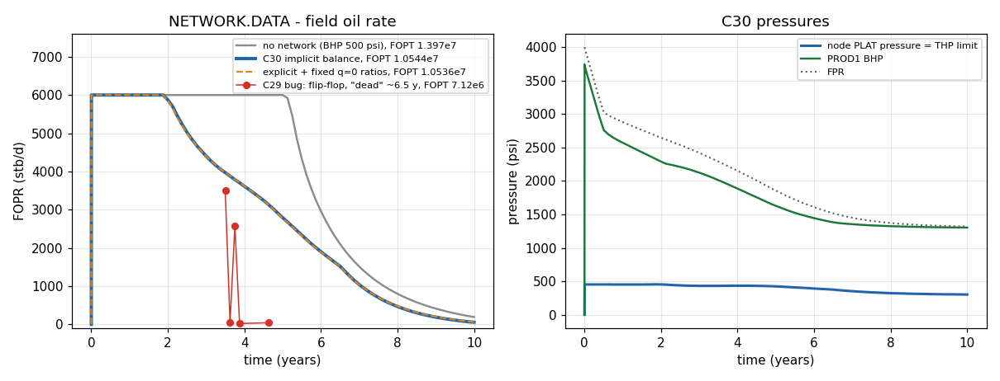
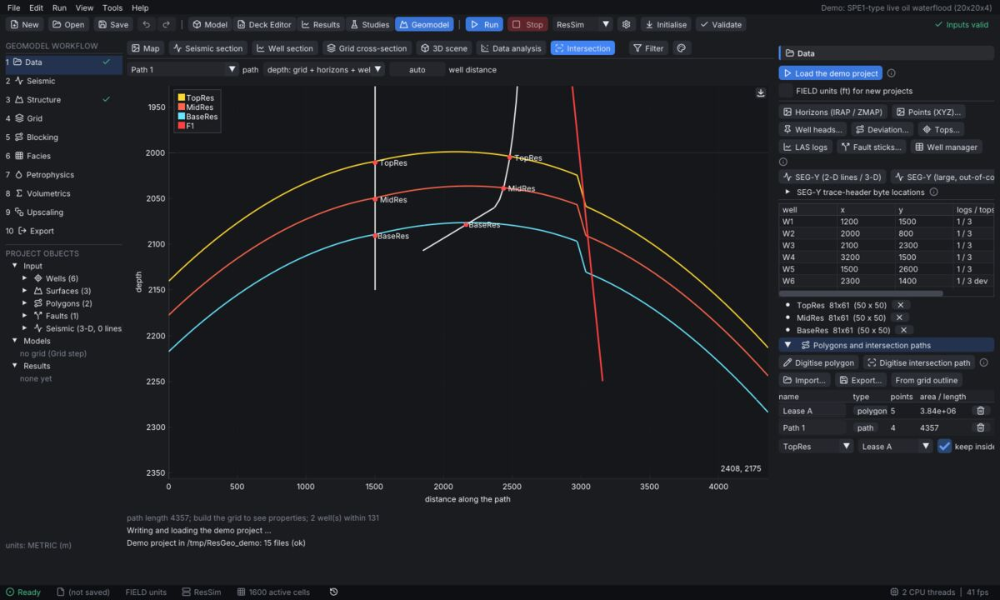
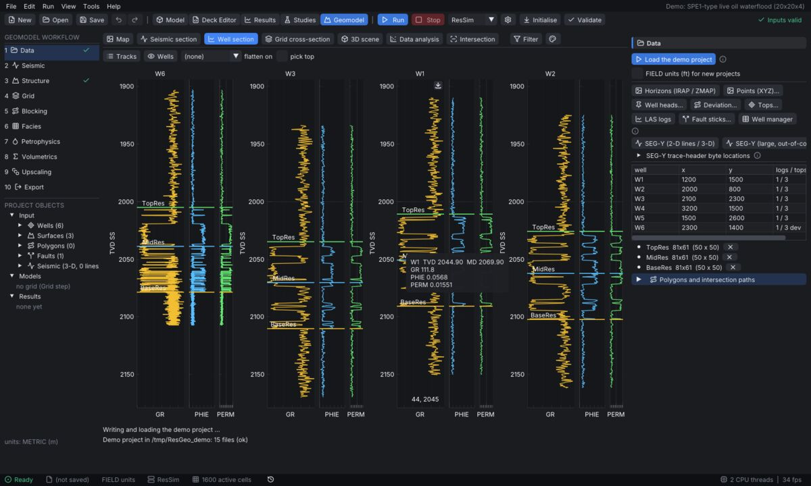

# ResSim Studio — User Guide

*Version: Round C27 (October 2026). This guide is updated with every release; the change log at the end lists what changed.*
*Open it at any time from **Help → User guide** or with **F1**.*

---

## 1. Quick start (5 minutes)

1. **File → Examples** → pick *Quarter five-spot waterflood* (or open any file from the `examples` folder).
2. Press **F5** (Run). The status bar shows time-step progress; **Shift+F5** stops the run.
3. Switch to **Results** (Ctrl+3): field rates, well plots, 3D maps of pressure / saturations, convergence.
4. Change something in **Model** (Ctrl+1), e.g. *Wells → rate*, and press F5 again.
5. **File → Save** stores the model as an ECLIPSE-format `.DATA` deck; **File → Save results (.rsres)** stores the run.

| Shortcut | Action |
|---|---|
| Ctrl+1 / 2 / 3 / 4 | Model / Deck Editor / Results / Studies workspace |
| F5 / Shift+F5 | Run / stop |
| F1 | This guide |
| Ctrl+N, Ctrl+O, Ctrl+S | New, open, save |
| Ctrl + / Ctrl − / Ctrl 0 | Interface size |
| Ctrl+Shift+P or Ctrl+K | **Command palette** (C26): type what you want to do |

### 1.1 Finding your way (C26)
* **Start page** (*Help → Start page*; shown at start-up unless you untick it in *View → Settings → Interface*): new demo or blank
  model, open / import, **recent files**, the built-in example library and the example **decks** shipped next to the program
  (`examples\`, `decks\`) with their description — one click opens a deck.
* **Command palette** (Ctrl+Shift+P, or Ctrl+K outside the Deck Editor): every menu action, model section, example, example
  deck and recent file by name. Type a few letters (fuzzy search), Up / Down, Enter. Nothing has to be found in the menus.
* **Recent files**: *File → Recent* (projects, decks, results), also on the start page and in the palette.
* **Workflow checklist** (top of the Case Explorer): grid → fluids → rel. perm → initial state → wells → schedule → validate → run →
  results → save, each with its state (done / needs attention / results out of date); click a step to go there.
* **Notifications** (bell in the status bar): every message with its time, errors marked — messages no longer disappear unseen.
* **Run history**: every finished ResSim run is added to *Results → Cases, vectors & compare* with **what changed** against the
  previous run (input lines removed / added) — what-if comparisons without saving result files by hand. Switch off in
  *View → Settings → Interface*.

---

## 2. The five workspaces

### 2.1 Model (visual input)
The left panel holds the input sections; the centre shows the 3D model (same viewer and options as in Results).

| Section | What you edit |
|---|---|
| Run specification | title, units (METRIC / FIELD / LAB), phases, start date, dimensions |
| Grid & rock | Cartesian or corner-point grid, layers, PORO / PERM / NTG, regions (SATNUM, PVTNUM, EQLNUM, FIPNUM), faults + MULTFLT, NNC, LGRs (CARFIN), dual porosity / permeability, MINC, **hydraulic fractures & unconventional rock (C15)** |
| Fluid (PVT / EOS / CO2) | black-oil tables (PVTO/PVDG/PVTW, correlations), compositional EOS (components, BIC, phase envelope, flash), CO2STORE, thermal components (E300 THERMAL) |
| Rel. perm & Pc | SWOF / SGOF / SOF3 tables, Corey generator, end-point scaling, hysteresis |
| Initialization | EQUIL contacts, RSVD / RVVD, SWATINIT, fluids in place |
| Aquifers | Fetkovich, Carter-Tracy, numerical |
| EOR (polymer, chemical, solvent) | polymer, salt, surfactant, alkaline, foam, solvent (immiscible SSFN model) (C35) |
| Wells | well heads, trajectories (horizontal wells drawn along the real path), completions, VFP |
| Schedule | dated events: controls, rates, shut / open, groups, ACTIONX |
| Numerics | time stepping, Newton / linear solver (CPR-AMG), tolerances |
| Advanced keywords | any keyword not covered by a form is kept and exported unchanged |

### 2.2 Deck Editor (writing mode)
Syntax-highlighted ECLIPSE / OPM deck editor with keyword reference, tooltips, snippets (tab stops), checker and import report. **File → Open current model as deck text** shows the deck that the forms produce. Decks round-trip: import → edit → export without breaking keywords.

### 2.3 Results
Tabs: **Field**, **Wells**, **Thermal**, **Geothermal**, **Components** (multi-component runs: per-component rates, products such as H2 / syngas), **Custom plots** (your own saved plot selections), **Convergence**. The 3D view shows any cell property per report step (time slider / animation), streamlines (Tools menu), fracture panels.

**Colour range of the 3D view (C18.1):** with *Auto range* ticked, the box next to it chooses **All time steps** (default: one fixed scale = min / max of the property over every report step, so a colour means the same pressure / saturation at every time — use this to follow fronts and depletion) or **This step only** (rescaled at each step for maximum contrast; colours are then not comparable between steps). Untick *Auto range* to type your own fixed range. The choice is remembered and applies to both the Results workspace and the external-results (ECLIPSE / OPM) viewer.

### 2.4 Studies
**Parameters → Observed data → Sensitivity → History matching**. Sensitivity: tornado, Monte Carlo. History matching: manual, automatic (derivative-free) and **adjoint gradient** methods with the iteration view, final parameters and best-case response checks.


### 2.5 Geomodel (ResGeo, C32)
Data → seismic → structure → grid → blocking → facies → petrophysics → volumetrics → upscaling → simulation case; see §7f.
Standalone: **ResGeo.exe** / `ResSimStudio.exe --geo`.

---

## 3. Simulation engines

| Engine | Use |
|---|---|
| **ResSim (built-in)** | black oil (FIM, CPR-AMG), compositional (EOS, natural variables), CO2STORE, thermal (STARS-like: steam, combustion, UCG, geothermal), geomechanics (THM), adjoint. Only ResSim runs the `-- RESSIM:` extensions (MINC, HFRAC, LANGMUIR, PERMSTRESS, FRACTURE, SORB ...). |
| **OPM Flow** | external `flow.exe` (auto-detected or browsed in *Run → Simulation engine settings*). |
| **ECLIPSE** | external, licensed (`eclrun`). |

Select the engine in the **Run** menu. ResSim extensions are written as comment lines (`-- RESSIM: ...`), so the same deck still runs in OPM Flow / ECLIPSE (which ignore them).

---

## 4. Tables — Excel-style editing (C15)

Every converted data table (layers, schedule, components, BIC, hydraulic fractures, stability planes ...) works like a spreadsheet:

* **Select**: click a cell; Shift+click, Shift+arrows or drag for a block; click / drag the row numbers to select whole rows, click a column title to select the column (Shift+click extends to more columns); click "#" or press Ctrl+A to select all.
* **Copy / paste**: Ctrl+C copies the selection as tab-separated text (pastes directly into Excel); Ctrl+V pastes text from Excel, LibreOffice, a web table or another table. If the clipboard block has the same size as the selection it is pasted exactly; a single value fills the whole selection; a larger block extends from the current cell (new rows are appended where the table allows it).
* **Edit**: type to overwrite (F2 / Enter / double-click edits the current value), Tab moves on, Esc cancels, Delete clears (deletes the rows when whole rows are selected), Ctrl+D fills down, Ctrl+X cuts.
* **Right-click menu**: Copy, Copy with headers, Cut, Paste, *Replace the whole table with the clipboard*, Fill down, Clear cells, Insert rows above / below, Delete selected rows, Select all.
* Columns are resizable; values are never hidden behind narrow headers.
* **C16:** the remaining tables use the same spreadsheet editor — aquifers (Fetkovich / Carter-Tracy), thermal components, solids, sorption, water-injection and trapping tables, EDFM fractures, mineral trapping, separator stages, MECHBC plates. Choice columns (e.g. aquifer type, phase) open a drop-down; computed columns are read-only (grey).
* *For developers:* a new table is one `RecordTable<T>` declaration in `widgets.h` style — one line per column (`.num`, `.integer`, `.text`, `.choice`, `.flag`, `.computed` …) — and it gets selection, copy / paste, insert / delete and undo-safe change notification automatically.

---

## 4a. High-performance computing — *Run → Simulation engine settings → HPC* (C16)

| Option | What it does | When to use |
|---|---|---|
| **Threads** | OpenMP threads of the ResSim engine (assembly, linear solver). | always; default = physical cores |
| **Mixed precision** | the block ILU(0) preconditioner is stored and applied in single precision (half the memory traffic); the outer Krylov solve and Newton stay in double, with a double-precision rescue if the float factorisation fails. | large black-oil models; results are identical to the double run to solver tolerance |
| **GPU solver** | Direct3D 11 compute shaders (block-Jacobi BiCGSTAB inner solve with double-precision refinement on the CPU); automatic fallback to the CPU when no GPU / failure. *Test GPU* in the same panel shows the device and a timing. | models with > 100 k cells and a discrete GPU |
| **MPI batch** | runs Studies (sensitivity, HM, ensembles) case-parallel across processes / machines with `mpiexec -n N ResSimCLI.exe --mpi-batch jobdir` (MS-MPI on Windows, MPICH / Open MPI on Linux). Progress and cancel in the app; falls back to local parallel runs if MPI is missing. *Test MPI* checks the installation. | many runs (Studies) |

| **MPI: single runs, domain decomposition** (C18) | tick *Single runs: domain decomposition* under MPI and set the ranks: *Run* then starts `mpiexec -n N ResSimCLI.exe case.rsim --mpi-dd` in the run folder; the Newton linear solve is split over the ranks (CPR: global AMG pressure stage + block-Jacobi BILU0 per rank) and the results load back into the Results workspace as usual. | black-oil models large enough that the linear solver dominates; ranks ≤ physical cores. Compositional / thermal cases run locally from the app (a note is logged); since C20 they run domain-decomposed from the command line: `mpiexec -n N ResSimCLI.exe X.DATA --mpi-dd` (results file holds the summary). |
| **GPU device preconditioner + Benchmark** (C18) | *Device preconditioner*: block-Jacobi or **multicolour BILU0** (ILU on the device, one pass per colour). *Benchmark CPU vs GPU* times CPU BILU0, CPU MC-BILU0, GPU Jacobi and GPU MC-BILU0 on growing test matrices and shows wall time, device-busy time and readbacks. | run *Benchmark* once on your machine: use the GPU only where it beats the CPU line. |

**Speed on one laptop / workstation (C21).** On a single machine **OpenMP threads are the fastest option**: measured on a 54 000-cell case
(2 cores) 1 thread 48.6 s → 2 threads 31.4 s, while 2-rank domain decomposition took 36.0 s (it adds ~40 % solver iterations because the ranks only
exchange halo data). Recommendations: keep *Threads* at its default (one per **physical** core — hyper-threads slow the bandwidth-bound solver);
use **MPI DD** only across several machines, or for memory; if you use DD on one machine, the panel sets *ranks × threads ≤ physical cores* and passive
waiting (`OMP_WAIT_POLICY=PASSIVE`) automatically — without it idle ranks and threads spin and Task Manager shows ~100 % CPU without any speed-up.
The **GPU** solver helps only on a discrete GPU with large models; a laptop iGPU is usually slower than the CPU (the AMG pressure stage still runs on
the CPU). The HPC panel's *Advisor* line shows the recommended setting for the open model.

**MPI troubleshooting (Intel MPI "error code 5 / Access is denied").** Press *Test MPI*; the log ends with a *Diagnosis* block. Usual fixes, in order: (1) right-click ResSimCLI.exe → Properties → *Unblock* (or copy the release folder out of Downloads, e.g. to `C:\ResSim`); (2) allow the folder in the antivirus / Controlled Folder Access; (3) Intel MPI older than 2021.6: put `-localonly` in *Extra mpiexec arguments*; (4) or install Microsoft MPI (msmpisetup.exe) and leave the mpiexec field empty. `ResSimCLI.exe --mpi-info` prints which MPI library would be used.

**AMG reuse across time steps (C26)** — *Numerics → AMG reuse across time steps* (deck `-- RESSIM: TUNING` field 7, default 10,
0 = rebuild every step): the CPR pressure hierarchy is kept for up to N time steps of a report step and rebuilt early if the
linear iterations rise. Small gain (Egg −3 %), identical results, restarts stay exact.

**Command line for scripting and batch work (C26).** `ResSimCLI.exe X.DATA [options]`:

| Option | Effect |
|---|---|
| `--check` | read and validate the deck only (grid size, wells, report steps, warnings); exit code 0 = valid |
| `--set "KEY=value"` (repeatable) | change the deck before the run: an ECLIPSE keyword's data up to its first `/` (e.g. `--set "PERMX=3000*100"`), or a ResSim line `--set "RESSIM:FAULTSLIP=20 0.25 0.1"` (replaced or added) |
| `--json file.json` | run summary as JSON: engine, time, statistics, 13 field vectors, final values and fault / geomechanics KPIs |
| `--csv file.csv` | field vectors as CSV (TIME, FOPR, FWPR, …, FGOR) |
| `--version` | engine version |
| `--list-examples` (C27) | the 31 built-in example cases (id, title, physics) |
| `--example ID [-o X.DATA]` (C27) | writes a built-in example as an ECLIPSE deck, ready to run or edit |

Coupled decks (fault mechanics, FE geomechanics incl. the iterative coupling, DDM apertures) run with the same coupling as
the app. Since C27, studies (sensitivity / uncertainty / history matching) also run the coupled physics of the case: the
responses *Expected seismic events*, *Max Mw*, *Max dCFS*, *Max uplift* and *Max failure index* can be put in tornado, Monte
Carlo and HM (the MPI batch runner still evaluates flow responses only).

`ResSimCLI.exe X.DATA [-o out.rsres] [-threads n]` runs a case without the GUI; `mpiexec -n N ResSimCLI.exe X.DATA --mpi-dd -o X.rsres` runs it with domain decomposition. Limits: in DD runs the Jacobian assembly and the AMG pressure stage stay on rank 0 (only the solve is distributed); GPU numbers measured here come from a software renderer — use *Benchmark* on your GPU.

---

## 5. Plots and export

Every plot has a small **export icon** (top-right corner while the mouse is over the plot): click it — or right-click the plot — to export that single plot as vector **PDF** or high-resolution **PNG**. **Custom plots** saves your own combinations of curves and shows them after every run. Logarithmic axes (e.g. rate vs time on log-log) are kept in the vector export with decade and minor ticks; long axis labels shrink to fit the figure height (C17).

**Exact export (C22) and native publication export (C23).** The export dialog has two modes:

| Mode | What is exported |
|---|---|
| **Exact (as on screen)** — default | the plot **exactly as it is on the board**: grid lines, heatmap / cell backgrounds, shaded bands, fracture and well markers, annotations, legend, axes, colour scale and the current zoom. PDF / SVG keep it as vector geometry with real text; PNG is a sharp raster |
| **Publication (journal style)** — C23 | the plot **re-drawn natively** with journal fonts, line widths, palettes, ticks and legend — and now **everything else too**: heatmaps / cell maps with a real colour bar, model-cell outlines, filled bands, bars, fracture traces and tips, wells, outlines and text labels. Light lines made for the dark screen print dark on paper. Use this for papers and reports |

* **Capture / Re-capture from screen**: the snapshot is taken from the plots as they are displayed. If you zoom or change colours afterwards, press *Re-capture*. The plots must be visible on screen (open their tab first).
* **Print colours (light background)**: turns the dark theme's background, text and grid into a white page with black text and light-grey grid. Series colours and colour maps are kept.
* **Pixel scale** (PNG, exact mode): *1x* gives the same pixels as the screen, *2x–4x* sharper copies; *Use dpi below* sizes the PNG from the width and dpi.
* The width is free; the aspect ratio is the on-screen one. Greek letters in PDF text come out as "?" (the standard PDF fonts have no Greek glyphs) — use SVG or PNG when an axis label contains Greek.

---

## 6. Results, restart and file formats

* **File → Save results (.rsres)** / **Open ResSim results**: complete run (summary, report steps, grid).
* **Export results as ECLIPSE files**: EGRID / INIT / UNRST / UNSMRY / SMSPEC readable by ResInsight, OPM tools and the built-in viewer (only main-grid cells are written; LGR / MINC / fracture cells are reported in the warnings).
* **Run → Restart from a report step**: continue a run from any saved step with changed schedule.
* **View → Result Viewer**: open and compare ECLIPSE / OPM output.

---

## 7. Fractured and unconventional reservoirs

| Need | Tool | Engine |
|---|---|---|
| Naturally fractured (sugar-cube) | DUALPORO / DUALPERM, MINC shells | ResSim black oil, compositional / CO2 and thermal (MINC in all three since C17; DUALPORO also OPM/ECLIPSE) |
| Large discrete fractures, EGS | `FRACTURE` (EDFM with aperture mechanics), EGS designer, stimulation sizing | ResSim thermal |
| **Hydraulic fractures in conventional or unconventional black-oil / compositional reservoirs** | `HFRAC` (EDFM), multistage designer | ResSim black oil + compositional |
| Shale / coal adsorbed gas | `LANGMUIR` (black oil), `SORB` (thermal, competitive, temperature-dependent) | ResSim |
| Stress-dependent permeability | `PERMSTRESS` (matrix), HFRAC gamma (fractures) | ResSim |
| Fault / fracture stability, induced seismicity | Tools → Geomechanics window | ResSim (post-processing of any run) |
| **Injection schedules that minimise induced seismicity** (C20) | Tools → Geomechanics: seismicity-aware injection design | ResSim black oil |
| **Fracture opening / slip with friction (contact mechanics)** (C20) | Tools → Geomechanics: fracture contact & slip (2-D) | ResSim (stand-alone mechanics) |
| Hydraulic fracture height growth through stress barriers (C20) | Hydraulic fractures → designer → model *P3D* | ResSim |

### 7.1 Hydraulic fractures (HFRAC) — *Grid & rock → Hydraulic fractures & unconventional*
Each fracture is a vertical plane given by its trace (x0, y0) → (x1, y1), depth range, width, permeability, porosity, conductivity decline gamma and optional SATNUM. The grid cuts each plane into **fracture cells** (embedded discrete fracture model) connected to their host cells (T = 2 A k / ⟨d⟩), to each other along the plane and to every well perforated in a host cell. Works for Cartesian and corner-point grids, single and dual porosity, black-oil and compositional runs.

**Multistage designer:** choose the well, number of stages, spacing (0 = evenly along the completed length), orientation (perpendicular to the well, or along S_Hmax) and the geometry — either typed in, or **sized from the pump schedule**: rate, time, viscosity, E, ν, leak-off, toughness and closure stress run the PKN or KGD propagation model; the pumped proppant mass gives the propped width (w = M / (ρ_p (1−φ_p) 2 L_p H)). *Replace* or *Append* writes the table. The pre-check line shows how many fracture cells the grid preview created.

Deck lines (ResSim only):
```
-- RESSIM: HFRAC name x0 y0 x1 y1 zTop zBot width perm poro [gamma] [satnum]
--   zTop/zBot -1 = full grid thickness; perm 0 = cubic law w^2/12; width in length units
-- RESSIM: LANGMUIR VL PL rhoGrain      -- METRIC sm3/t, bar, g/cm3; FIELD scf/ton, psia, g/cm3
-- RESSIM: PERMSTRESS gamma             -- k = k0 exp(-gamma (p_i - p)), 1/pressure unit
```
Results: fracture panels in the 3D view coloured by the cell pressure / saturation, rates and cumulative production, adsorbed gas in the fluids-in-place.

**Fracture growth during the run (C18)** — open *Fracture growth during the run (LEFM)* below the fracture table (one row per fracture, Excel-style). Set **K_IC** > 0 and the fracture grows while the simulation runs:
* the trace in the main table is the **maximum** length; at the start only the part within the *initial half-length* of the well is open (the closed rest behaves like the host rock);
* after every time step the tip of each wing is tested: **K_I = (p_fracture − σ_min) · √(π · min(L, H/2))**; if K_I ≥ K_IC the next piece opens (one piece per wing per step);
* σ_min is the minimum horizontal stress at the fracture mid-depth (+ gradient × depth difference); typical K_IC: shale 0.5–2, sandstone 0.5–1.5, granite 1–3 MPa·m^0.5;
* the run log shows `fracture F1 wing + grows to 65 m at t = 4.5 d (K_I 1.3 MPa m^0.5 >= K_IC 1)`; the Results 3D view has the cell array **HFOPEN** (1 = open);
* what to expect: under injection the pressure climbs to about σ_min + K_IC/√(πH/2) and then stays there while the fracture grows (example: σ_min 340 bar, H 10 m → ≈ 342.5 bar); higher σ_min → slower growth;
* limits: black-oil engine; straight vertical growth along the given trace; a piece = one host cell along the trace (refine the grid for smoother growth); adjoint HM is not available while fractures grow (use the ensemble / FD methods).

Deck line: `-- RESSIM: HFGROW name K_IC sigmaMin [dSigma/dz] [initialHalfLength] [closedMultiplier]` (after the HFRAC line of that fracture).

Verification (tests `-hfbo`): EDFM fracture vs Gringarten uniform-flux solution within 3.7 %; Langmuir material balance exact; corner-point = Cartesian to 1e-8.

**Multi-cluster stage: stress shadowing & limited entry (C17)** — in the designer tick *Size from the pump schedule*, then open *Multi-cluster stage*. Enter the clusters per stage, cluster spacing, perforations per cluster, perforation diameter, discharge coefficient (0.6 new, ≈ 0.9 eroded) and fluid density; the *Perforation friction* line shows the pressure drop at an even split. In the cluster table you can give each cluster a **stress offset** (MPa, e.g. a harder layer); the other columns are results. *Simulate the stage* grows all clusters together from one wellbore pressure:
* every cluster opens against S_hmin + its offset + the **stress shadow** of the open neighbours (Sneddon crack) + its perforation friction;
* the plots show each cluster's share of the pump rate over time and the final half-length per cluster;
* typical result: with tight spacing the outer clusters take most of the fluid and the inner ones stay short; more perforation friction (fewer / smaller holes = *limited entry*) evens them out;
* *Use the mean cluster half-length for the stages* writes the (propped) mean length into the stage design.

Example: 5 clusters, 10 m apart, 6 m³/min, 10 min — no shadow: 5 × 166 m; with shadow 240 / 96 / 110 / 96 / 240 m; with 4 × 10 mm perforations per cluster 170 / 165 / 164 / 165 / 170 m.

### 7.3 Steam producers: steam trap and steam-rate limit (C17)
*Thermal → Steam injection → Producer steam trap and steam-rate limit* (deck `-- RESSIM: STEAMTRAP 'well' subcool [steamMax]`). **Subcool** keeps the producer BHP at the saturation pressure of (hottest connection temperature + subcool), so live steam stays in the reservoir. **Max steam** (CWE volume per day) caps the produced steam: the well switches to a steam-rate control inside the Newton iterations whenever the limit would be exceeded and back when it is not (SPE4 2A: limit held in every report after breakthrough).

### 7.4 Diffusion and mechanical dispersion (compositional / CO2)
*CO2 storage → Trapping & interactions → Solubility & diffusion*, or *Compositional → Diffusion & hysteresis → Diffusion* for hydrocarbon runs. Molecular diffusion uses DIFFUSE + DIFFCWAT / DIFFCGAS / DIFFC. Since C17 **mechanical dispersion** can be switched on in the same tab: one dispersivity for all cells, or per-cell values from the deck array `DISPERC` (OPM Flow GRID keyword, length units). Mixing then grows with the flow velocity (flux = α |v| × concentration difference) — SPE11A uses 0.01 m, SPE11B/C 10 m. ECLIPSE has no DISPERC; OPM Flow reads it.

### 7.2 Geomechanics: fault & fracture stability — *Tools → Geomechanics*
The window opens as a tab next to the 3D Viewer (drag the tab out to float it, or double-click the tab bar to maximise). Inputs are on the left, results on the right.

* **Tip – no event?** With the poroelastic stress path switched on, a pressure increase also raises S_h and S_H, which can *stabilise* a normal fault (the window says so and prints the final τ/σ'_n). Switch the stress path off to model localised injection close to the fault.
* **Stress state**: depth, S_v / S_Hmax / S_hmin gradients, S_Hmax azimuth, pore-pressure gradient, Biot, ν, friction μ and cohesion; the faulting regime is shown.
* **Pore pressure**: hydrostatic + change, or from the last ResSim run (field average, maximum cell, or one cell I, J, K) with the **poroelastic stress path** ΔS_h = ΔS_H = α(1−2ν)/(1−ν) Δp.
* **Planes**: strike / dip table (filled from the hydraulic and thermal fractures plus the optimally oriented fault).
* **Outputs**: effective normal and shear stress, slip tendency T_s = τ/σ'_n, dilation tendency, Coulomb failure stress CFF, critical pressure increase ΔP_crit and state (stable / critical / slipping); **Mohr diagram** (initial and current circles, Coulomb envelope, plane points), **evolution** of T_s and ΔP_crit with time, **stereonet** (slip tendency of every orientation, lower hemisphere equal area), **reservoir cells** above the Coulomb line, and **fracture movement**: rate-and-state friction slip driven by the pressure history (stick-slip vs stable creep, events with slip, peak velocity, M_0 and M_w) with the Barton-Bandis aperture and the resulting permeability multiplier.

The 3D FEM of the thermal THM option (`sagd_thm` example) now has **elasto-plasticity (C16)** — *Thermal editor → Geomechanics → Plasticity and damage*:

* **Drucker-Prager** yield surface matched to Mohr-Coulomb (outer cone, inner cone or plane strain), non-associated flow with a dilation angle, cohesion **softening / hardening** to a residual cohesion; implicit return mapping with Aitken-accelerated equilibrium iterations.
* **Damage permeability**: k = k0 · exp(c · ε_p,vol) (capped), fed back into the flow every step — plastic dilation opens permeability.
* **Boundary conditions** per face: fixed, traction, roller, or **rigid plate** (load- or displacement-controlled) for laboratory-style tests (`-- RESSIM: MECHBC` / `GEOPLAST`).
* Results: equivalent plastic strain `EPSPLAS`, plastic volume strain `EPSPV`, permeability multiplier `KDAMAGE` in the 3D viewer and time plots.
* Verified: platen test reaches the Mohr-Coulomb strength exactly (45.07 MPa), softening to the residual strength, Mandel and Cryer consolidation (< 0.3 % error).


### 7.5 Seismicity-aware injection design (C20) — *Tools → Geomechanics: seismicity-aware injection design*
Designs the injection-rate schedule that produces the **fewest expected induced earthquakes** for the volume you must inject, on the faults you mark.

1. **Fault patches**: one row per fault cell (I, J, K) with friction, stress-path factor, Aσ̄ (MPa, typically 0.01–0.1), aftershock time t_a (years), background rate (1/yr) and a weight. dCFS = friction × stress-path factor × Δp.
2. **Designed injectors**: the water / gas injectors of the case are listed with their volumes (*Volume per well* keeps each well's own volume, otherwise only the total is fixed).
3. **Schedule and objective**: injection window and post-shut-in horizon (days) — **count the post-shut-in events**, otherwise step-up schedules look falsely good; control intervals and report steps; *Max rate / mean rate*; *Objective* (expected events, peak rate, or a mix with *Peak weight*); *Model-correction passes*.
4. **Design injection**: the engine computes the stress response of every patch to every injector interval, the optimiser solves the (provably convex) minimum-seismicity problem, and the design is **re-simulated**; each correction pass removes the superposition error (*Model correction* tab: predicted vs simulated).
5. Results (*Injection schedule* tab): the designed schedule vs constant rate (events, peak rate), **Open designed case** (a copy with the new schedule) and **Copy SCHEDULE text**.

If the log warns that the response is **strongly nonlinear** (for example a fracture that grows during injection, or BHP limits taking over), the designer relies on the verification runs and returns constant rate when nothing better was verified; reduce *Max rate / mean rate*.

**Design potential and the shut-in burst (C22, research finding F12).** After a design the panel shows
*Design potential (first-order reference)*: Π (maximum Coulomb change / Aσ̄ of the constant schedule), θ (stress response time / injection window) and
the gain that the exact optimum would reach for a first-order (saturating) stress response — with and without a shut-in burst.

* θ ≪ 0.1: the stress follows the rate — constant rate is already close to optimal, but rate **spikes are expensive**.
* θ ≈ 0.1–1: the largest benefit from a designed schedule.
* The reference is exact for first-order responses; radial / linear diffusive responses reach roughly ¼ to ¾ of it. **The designed schedule is the real number**; "at least" means θ is outside the validated range of the closed form.
* The event-count optimum opens with a high-rate *charging* interval and tends to end with a **burst at the rate limit just before shut-in**. That lowers the count but raises the stress at shut-in, where large post-injection events are a known risk (Basel 2006, Pohang 2017). The panel warns when the design ends at its rate bound. Set **Last-interval rate / mean** to 1 (or lower) to forbid the burst; 0 = off.

**Calibrate from observed stage events — does the rate matter? (C23, research finding F14).** Below the designer: one row per stage of a past
stimulation (test / interval number, injected volume, hydraulic energy ∫p q dt, mean rate, duration, located events). **Fit kernels** ranks the event-count
kernels (constant, duration, volume, energy, volume × rate^β, volume × (1 + earlier volume)^γ and both together) by AIC with a separate productivity per test
and reports the **rate exponent β at fixed volume** with its 95 % interval. If the interval contains 0, the data show no rate effect and a slower schedule
will not reduce events by itself — only less volume (or energy) will. *Aspo HF1 + HF2 example* loads the Äspö HRL 2015 stages: best kernel volume ×
(1 + earlier volume)^0.45, β interval [−1.25, 0.75] → no resolvable rate effect.

Tips: the gain is largest when the fault is close to failure relative to Aσ̄ (strong nonlinearity); spreading the volume over several wells usually helps more than reshaping one well's rate. Black-oil cases only (compositional / thermal later).

### 7.6 Fracture contact & slip (embedded fractures, C20) — *Tools → Geomechanics: fracture contact & slip (2-D)*
A plane-strain mechanics section (width × height, rollers on the left and bottom, far-field stresses on the right and top; tension +, compression −) with any number of straight fractures that **cut the mesh anywhere** — no meshing along them.

* **Fractures table** (Excel-style): end points, fluid pressure, friction coefficient, cohesion. Put end points on element edges for the most accurate tips; keep fractures at least one element apart.
* **Solve**: the fractures open where the pressure exceeds the normal stress, stick where |τ| < c + μσ_n and **slip** otherwise (Coulomb friction, penalty contact, full Newton).
* **Results**: *Along the fractures* — opening and slip (mm) and normal / shear contact traction (MPa) vs distance from the fracture centre; *Stress map* — σ_xx, σ_yy, σ_xy or maximum shear with the fractures drawn on top; the status line counts open / stick / slip elements.
* **Jump interpolation**: *Continuous jumps* (default, accurate on any mesh) or *Element-constant jumps* (classic EFEM, kept for comparison: it over-predicts slip by 10–25 % on meshes oblique to the fracture).
* Accuracy (built-in tests, 100 × 100 elements, crack ≈ 24 elements long): pressurised (Sneddon) crack volume within 2 %, frictional slip of an inclined crack within 5 %, locked crack correctly stays locked.

Example: default setup (a 30° fracture with μ = 0.3 under σ_yy = −10 MPa) → the fracture slips (tan 30° = 0.58 > 0.3). Set friction to 0.8 → no slip. Set friction 0, σ_yy = 0 and pressure 1 MPa → the Sneddon elliptical opening.

**Coupled flow run (C21, G1-c).** Open a model with HFRAC fractures (e.g. `examples/HFGROW_INJECTION.DATA`), set rock and far-field stresses at
the top of this window (σ_yy acts across a fracture that runs along x), then under *Coupled flow run with the open case* choose the layer, the
fracture friction and the **Barton–Bandis** closure parameters (residual aperture, maximum closure V_m, initial normal stiffness K_n0), the dilation angle
and press **Run coupled**. After every report step the fracture pressures from the simulation load the fractures, the contact problem is solved and each
fracture piece's conductance is set from its aperture: closed fractures stiffen as the effective normal stress grows, fractures above the normal stress
open (width scaled to the fracture height, PKN), slipping fractures dilate. The *Coupled flow run (G1-c)* tab shows the aperture along the fractures,
the conductance-multiplier range over time and the injector BHP (coupled vs uncoupled). Command line: `ResSimCLI X.DATA --geocouple sxx,syy[,E_GPa,nu,friction,layer]`
(MPa, compression −). Limits: lagged by one report step, fracture-face pressure only (no poroelastic stress in the rock), black-oil.

**Rate-and-state fault: earthquake cycles and induced events (C23, G3).** In the left panel, *Rate-and-state fault*: a straight fault with a
velocity-weakening patch (a < b) between creeping ends (a > b), quasi-dynamic (radiation damping), aging law. Initial stresses are *Uniform* (length,
normal stress, pore pressure) or *From the contact solve* (σ_n and τ along the chosen fracture — press Solve first). Pore pressure: none, an
*Injection well* (line source: distance, pressure scale qμ/4πkh, diffusivity, shut-in time) or the *Last coupled flow run (G1-c)*. **Run fault** →
tab *Rate-and-state fault (G3)*: maximum slip rate and event magnitudes vs time, a space-time slip-rate map and the **event catalogue** (start, duration,
Mw, slip, rupture length, stress drop, hypocentre). The status line shows the nucleation length h* and the cohesive zone Lb: keep **Lb / element ≥ 3**
(a warning appears otherwise). Example: defaults → periodic Mw ≈ 4.4 events every ~5 years; add an injection well 50 m from the patch centre → the next
event comes years earlier. Accuracy (built-in `-c23`): spring-slider stability limit k/k_c, steady sliding to 6e-6, time-step independence 0.03 %.

**Phase-field fracture (C23, G4, experimental).** *Phase-field fracture* in the left panel: a pressurised crack of half-length a in an elastic plate
(E, ν, toughness Gc), element size h (the band width l = 2h). **Run phase field** ramps the pressure to 1.3 × the Griffith pressure. Tab
*Phase-field crack (G4)*: crack volume vs pressure with the Sneddon line and the Griffith pressure, half-length vs pressure (the jump = unstable growth),
and the phase-field map (0 = broken) at the critical pressure or at the end. No crack path is prescribed — this is the model to use when the path is
unknown (near-wellbore, lab samples). **Accuracy is controlled by l / a**: at l/a = 0.1 the volume is ~40 % high and the critical pressure ~5–10 % low;
both converge to Sneddon / Griffith as h is halved (extrapolated 0.96 / 0.975). Use h ≤ a/20 for numbers, a/10 for a quick look. Limits: 2-D, horizontal
initial crack, pressure-controlled (the run stops when the crack jumps), no fluid flow inside the crack.

Next steps of the deep-geomechanics plan: 3-D embedded fractures (G1b, C24), DDM/ILSA hydraulic fractures (G2), rate-and-state injection design (research H7).

**Continuous fracture tip, `HFGROW … SUBGRID` (C21, research option).** Add the word `SUBGRID` at the end of an HFGROW record (or tick *Sub-grid tip*
in the growth editor) and the fracture length grows continuously instead of one grid column at a time; the toughness criterion is solved inside every
time step (K_I within ~4 % of K_IC). It is 10–30× slower. Research finding: on coarse grids it is *not* more accurate than the default — the default
scheme reaches a given length too early and SUBGRID too late, both converging to the same answer as the grid is refined. Running both gives an
upper/lower bracket of the grid-converged growth time.

### 7.7 P3D height growth (C20) — *Hydraulic fractures → designer → Sizing model P3D*
PKN assumes the height stays equal to the pay zone. **P3D** lets every cross-section grow up and down until the stress intensity at both vertical tips equals the toughness, given the **stress contrast Δσ** of the bounding layers. Inputs: Δσ (MPa) and a height cap. Outputs: the length, the height at the well and the **profile plot** (height and width along the fracture). A warning appears when the net pressure approaches Δσ (**height runaway**: the barrier no longer contains the fracture). With a very large Δσ the result equals PKN.

### 7.8 Fault mechanics & induced seismicity in the run (C24) — *Grid & rock → Faults → Fault mechanics*
Faults are part of the model, not a separate tool. Define faults (FAULTS), then tick **Compute fault stresses and seismicity during the run**:
1. **Stress field:** vertical stress gradient, Shmin/Sv, SHmax/Sv, SHmax azimuth, poroelastic stress path.
2. **Fault table (Excel-style):** per fault friction, cohesion, Aσ (default 0.003·σ′n), aftershock time t_a, background rate r₀, b-value, M min,
   **T factor when slipping** (> 1 = two-way: reactivated faces conduct, the flow sees it in the next report step) and an optional **RSF layer**
   (rate-and-state rupture model on that layer, a, b, Dc).
3. **Pre-check initial fault state** shows the CFF / slip tendency on a hydrostatic gradient before you run.
4. Press **Run**. The log reports the coupling; the main **3D view** shows every fault face coloured by the chosen quantity (CFF, ΔCFS, slip tendency,
   σ′n, seismicity rate, events per km², T multiplier — fixed colour range over the run) and the **events** up to the current time (yellow = last report
   step, grey = older, magenta = rate-and-state ruptures). Move the time slider to follow the reactivation.
5. **Results → Faults & seismicity:** Coulomb stress, slip tendency, reactivated area, expected vs catalogue events, magnitudes, Gutenberg–Richter,
   along-strike × layer fault map, event catalogue, rate-and-state summary and (with GEOCOUPLE) the fracture-contact history. All plots export (PDF/SVG/PNG).

**Fracture contact in the run (GEOCOUPLE).** For models with hydraulic fractures the same section offers *Update hydraulic-fracture conductance from an
EFEM contact solve after every report step* (far-field stresses, E, ν, friction, slice layer) — the C21 G1-c coupling, now inside the normal Run.

Example: `examples/FAULT_INJECTION.DATA` (injector next to a near-critical fault, two-way coupling, RSF trace on layer 3; ~1 s).

### 7.9 Reservoir geomechanics on any grid, fracture growth against the FE stress (C25) — *Grid & rock → Reservoir geomechanics*

Three steps, no XFEM:
1. **Enable “Geomechanics (finite elements)”** (black oil / CO2; thermal decks: *Thermal → Geomechanics*). Set E, ν, Biot,
   padding layers, overburden gradient, k0, strength. *Coupling*: one-way (stress output, FE stress for faults/fractures) or
   two-way (pore volume and permeability follow the mechanics after each report step). *Stress-dependent permeability
   (1/bar)*: k/k0 = exp(−c Δσ'_m). Works on Cartesian **and corner-point** grids (the mesh is built from the corner points;
   dip and fault throws kept).
2. **Fracture growth against the FE stress**: *Hydraulic fractures → Fracture growth during the run*, set **FE stress = 1**
   (deck `HFGROW … FESTRESS`). The closure stress is then the minimum principal FE stress of each piece's host cell — it
   follows layering and poro-elastic stressing.
3. **Fault stress from the FE stress**: *Faults → Fault mechanics → Stress change source = Finite-element geomechanics*
   (deck `STRESSFIELD … FE`). Thermal decks may add the thermo-elastic term (`TH E α ν`).

Results: 3D view arrays SIGMIN, SIGEFFM, UPLIFT, STRAINV, FAILURE, KDAMAGE; *Results → Faults & seismicity*; run log lines
“geomechanics t = … uplift … failure …” and “fracture … grows to …”.

Examples: `GEOMECH_CP.DATA` (black oil, corner point), `CO2_GEOMECH.DATA` (CO2 storage), `EGS_FAULT.DATA` (EGS thermal).

**Iterative coupling (C26).** *Coupling = Two-way iterative*: each report step is repeated until the pore volume agrees with
the mechanics (*Fixed-stress iterations per step*, *Porosity tolerance*). Use it with long report steps or soft rock; with
short report steps the explicit two-way scheme gives the same answer (< 0.01 bar in the examples) at less cost. Black oil;
compositional runs use the explicit scheme (a log note says so). Deck: `GEOMECH ON 2 …`.

### 7.10 Fault slip, stress transfer and fracture apertures by boundary elements (C26)

* **Fault slip** — *Faults → Fault mechanics → Quasi-static fault slip with stress transfer (FAULTSLIP)* (deck `-- RESSIM: FAULTSLIP E_GPa nu dMu
  [slipRef_mm] [cutoff] [FULLSPACE|HALFSPACE]`): after every report step the fault faces that exceed the Coulomb limit slip
  until they are back at their strength; the slip loads the neighbouring faces (triangular dislocation elements, elastic half
  space). *dMu* > 0 adds slip weakening (cascades). Results: *Results → Faults & seismicity → Time series* (plots *Fault slip (DDM)*
  and *Seismic moment*), slip on the *Fault face map* and in the 3D fault panels, KPIs in the run log and in `--json`.
* **Hydraulic-fracture apertures** — *Hydraulic fractures → growth table → column DDM aperture (0/1)* (deck `HFGROW … DDMWIDTH [E nu]`): the open
  pieces of a growing fracture get their mechanical opening from the net pressure (p − σ_min) by boundary elements; the
  fracture conductance follows the opening (cubic law). Results: *Faults & seismicity → Fracture apertures (DDM)*.
* **Phase field** — *Tools → Geomechanics → Phase-field fracture*: new options *Loading = Injected volume* (stable growth after
  the peak pressure, plotted against volume with the toughness reference σ_n + K_IC/√(πa)), *Crack angle* and *in-situ stress*
  S_xx, S_yy, S_xy (net pressure and shear on the crack; the crack turns towards the maximum compressive stress). Since C28
  the phase field can also drive fracture growth **inside the field run** (§7b).

---

## 7a. Field management, tracers, time-step control and inversion statistics (C27)

Ideas from the comparison with CMG and TOUGH3 (full matrix: `COMPARISON_CMG_TOUGH3.md`).

* **Economic limits and well tests (WECON / WTEST)** — *Advanced keywords → + Add keyword* WECON / WTEST, or in the deck:
  `WECON 'P*' 1* 1* 0.9 1* 1* 'WELL' 'NO' /` (item 2 min oil, 3 min gas, 4 max water cut, 5 max GOR, 6 max WGR,
  7 workover WELL or NONE, 8 end the run YES / NO, 14 min liquid) and `WTEST 'P*' 200 'E' 3 /` (re-test every 200 days a well
  shut by an economic limit, at most 3 times). The ResSim engine now simulates both. The log reports every shut-in and
  re-opening, and restarts keep the state. OPM Flow runs the same records.
* **Passive tracers** — *Advanced keywords → Tracers*: name + phase → *+ Add tracer* (writes TRACER and a WTRACER record
  with concentration 1 for every injector of that phase). Per-tracer *half-life* (first-order decay) and *adsorption kd*
  (adsorbed amount per pore volume = kd·c, so the tracer is retarded by about 1 + kd/(b·S)) are ResSim extensions
  (`-- RESSIM: TRACERPROP name halfLife kd init`). Optional per-cell initial values: `TBLKF<name>` in SOLUTION. Results:
  *Results → Tracers* (produced concentration = breakthrough curve, production rate, % of the injected tracer recovered,
  table with breakthrough time and peak) for the field or one well. In 3-D: property *Engine output array* → `TR_<name>`.
  Custom plots: `FCPR / FCPT / WCPR …` with the tracer name. The transport runs after every converged step. It is
  implicit and upwind, so concentrations never go negative or exceed the injected value, and no extra time-step limit
  applies. Partitioning, dispersion / diffusion and decay chains were added in C28 (§7b).
  Example **TRACER_TEST.DATA**.
* **Time-step control on target changes** — *Numerics → Target saturation change / step* and *Target pressure change /
  step* (`-- RESSIM: TUNING` items 8 and 9; 0 = off). The next step is dt·min over the cells of (1+ω)·target/(change+ω·target),
  ω = 1 (Aziz–Settari). This gives smaller steps when fronts move fast and larger steps when nothing changes.
* **Van Genuchten–Mualem tables** — *Rel. perm & Pc → van Genuchten - Mualem generator*: residual saturations, m (= 1 − 1/n),
  P0 = 1/α (pressure units), Pc cap, end points, Parker or Corey non-wetting curve → SWOF or SGOF table
  (krw = √Se·[1 − (1 − Se^{1/m})^m]², Pc = P0·(Se^{−1/m} − 1)^{1−m}). These are the TOUGH3 / soil-physics functions
  written as ECLIPSE tables.
* **Inversion statistics after history matching** (iTOUGH2 style) — *Studies → History matching → Inversion statistics*
  (computed at the best parameters, a few extra runs): parameter standard deviations and 95 % intervals (covariance s0²(JᵀWJ)⁻¹ with s0² = misfit/(m−n)),
  correlation matrix (|r| near 1 = the parameters cannot be told apart; e.g. krw and water viscosity +0.998),
  composite scaled sensitivity per parameter, eigenvalues / condition number, residual statistics (mean, std, skewness,
  kurtosis), studentised residuals (|W| > 1.96 = outlier), leverage, and the share of each data set in the objective.
* **Coupled-physics responses in studies** — see the command-line section above.

---

## 7b. Uncertainty, tracers, geostatistics, production analysis, MPI and phase field in the run (C28)

The remaining items of the CMG / TOUGH3 comparison (COMPARISON_CMG_TOUGH3.md §4) and the open HPC / geomechanics items.

* **Prediction uncertainty and data worth (FOSM, iTOUGH2 style)** — *Studies → History matching → Inversion statistics →
  Prediction uncertainty (FOSM) and data worth*. Add predictions (any summary vector at a time, e.g. FOPT at the end of the
  forecast) to the HM study. After the match the prediction gets a standard deviation from the parameter covariance:
  σ_z² = g C_p gᵀ (g = dz/dp from the same runs, so no extra simulations), and a linearised 95 % interval. The *data worth* table
  shows how much each prediction's σ grows when one observed data set is removed (+44 % for the injector BHP in the test case)
  and how much it shrinks when a candidate data set is added (e.g. a GOR series −44 %). Use it to decide which measurement to
  pay for. Linear (first-order) analysis: check against a few Monte-Carlo runs when the parameters are far from linear.
* **Tracers: partitioning, dispersion, decay chains** — *Advanced keywords → Tracers* columns *K* (partition coefficient
  into the partner phase: water tracer → oil, gas tracer → oil), *parent* (Bateman chain: the decay of the parent produces this
  tracer), *alphaL* (longitudinal dispersivity) and *Dm* (molecular diffusion, length²/day). Deck:
  `-- RESSIM: TRACERPROP name halfLife kd [init] [K] [parent|1*] [alphaL] [Dm]`. Partitioning-tracer test (PITT): inject a
  conservative and a partitioning tracer together; the delay of the second gives the residual oil saturation
  S_or = (t_p/t_w − 1)/(t_p/t_w − 1 + K). The test case recovers S_or 0.2013 for a true 0.2. Decay chains are exact for any
  step (integrating factor), mass balance 1e-8.
* **Kriging / sequential Gaussian simulation** — *Grid & rock → Kriging / sequential Gaussian simulation
  (conditioned to wells)*. Hard data are the current values in the completed cells of all wells. Choose the property (PORO,
  PERMX as log10 k with PERMY = PERMX and PERMZ = kv/kh·PERMX, NTG), the method (ordinary kriging = smooth best estimate;
  SGS = one realisation with the variogram's variability, normal-score transform, seed) and the variogram (spherical,
  exponential, Gaussian; ranges along / across the azimuth, vertical range, nugget). Compare it with the *experimental
  variogram* of the current property before applying. Use different SGS seeds as an uncertainty parameter in a study.
* **Gaussian-process proxy** — *Studies → Proxy / optimisation → Proxy model = Gaussian process (kriging / ML)*. This is the
  CMOST-style ML proxy. It interpolates the training runs, takes ARD length scales from maximum likelihood and gives a
  prediction band. It is better than the quadratic response surface for non-polynomial responses (leave-one-out Q² 1.00 vs
  0.96 in the test).
* **Production analysis** — *Results → Production analysis* (black-oil runs):
  * Decline curves: Arps fit (exponential / hyperbolic / harmonic) of a well or field rate from the peak, forecast, EUR to the
    economic limit, and remaining reserves.
  * Nodal analysis: composite Vogel IPR from the run (J above the bubble point), and the VLP of a tubing (ID, roughness,
    depth, THP) from hydrostatic and Darcy–Weisbach friction on the case PVT. The operating point is where the two curves
    intersect.
  * *Create VFPPROD*: writes a VFPPROD table from the same tubing model into the case being edited (rates × THP × water cut ×
    GOR). The table is exact at the nodes.
* **Fault slip in EGS and CO2 runs** — FAULTSLIP / FAULTMECH now also work with the thermal engine (thermo-elastic
  cooling stress: cooling unclamps the fault) and with the compositional / CO2 engine together with the FE geomechanics. This
  applies in the GUI, in ResSimCLI and in studies / MPI batch runs (KPIs: slip, Mw, expected events, uplift).
* **MPI distributed assembly** — *Run → Simulation engine settings → HPC → MPI domain decomposition → Assembly =
  Distributed (C28)*, or `mpiexec -n N ResSimCLI deck.DATA --mpi-da`. Every rank evaluates the properties and assembles the
  Jacobian rows of its own cell slab. The Newton state is replicated, and the convergence norms and well decisions are
  reduced over the ranks, so the results are identical on every rank and equal to the serial run. SPE9 (9,000 cells) on 2
  ranks: 5.8 s vs 7.3 s with rank-0 assembly (`--mpi-dd`) and 7.5 s serial. Memory is still replicated per rank.
* **Level-ordered ILU(0)** — for large models (≥ 20,000 cells, ≥ 128 rows per level, several threads) the block ILU(0)
  is renumbered by its forward levels and stored contiguously. The parallel apply then streams through memory, and the
  factor is bitwise equal to the serial one. Override: environment variable `RESSIM_LEVEL_ILU` = 2 (always), 1 or 0 (off).
  On 2 cores the gain is small (2.09 ms vs 2.18 ms per apply on 54k cells); it is meant for 4+ cores.
* **Phase-field fracture growth inside the run** — *Hydraulic fractures → Fracture growth during the run → column phase field
  (0/1)*, plus *PF efficiency η*, *PF element h*, *PF E*, *PF ν*. Deck: `HFGROW name kic sigma sigmaGrad initLen closedMult
  PHASEFIELD [eta [h_m [E_GPa nu]]]`. A persistent 2-D plane-strain phase-field model of the fracture plane (AT2, volume
  control, irreversible damage, G_c = K_IC²/E′) is advanced at the end of every report step:
  * Its crack volume per height is V = η × (water injected by the wells completed in the fracture's cells) / fracture height.
  * Its half-length opens the EDFM pieces of both wings.
  * It replaces the LEFM piece test for that fracture.

  Choose η, the fluid efficiency (stored crack volume / injected volume). Use 0.05–0.6 for fracturing treatments, and much
  less for slow water injection (the test uses 0.002 for 2 m³/d). The phase-field pressure is shown next to the flow-model
  fracture pressure in *Results → Faults & seismicity → Fracture growth (phase field)*. The coupling is one-way by volume, so the
  two pressures differ when η does not match the leak-off of the flow model. Verification: the half-length is within 10 %
  of the toughness-regime Griffith–Sneddon length a = (E′V/(2√π K_IC))^{2/3} (32.1 m vs 35.5 m). The model runs in a worker
  thread and costs a few seconds per report step on a 2-D mesh with h ≈ L_max/60. It is not part of restart files: after a
  restart it starts again from the initial crack and keeps the pieces that are already open.
* **Sub-grid leak-off** — *Hydraulic fractures → Fracture growth during the run → column sub-grid leak-off (0/1)*, used
  together with *sub-grid tip = 1*. Deck: `HFGROW … SUBGRID LEAK`. A fresh host cell at the tip no longer leaks off as if
  the whole cell were exposed, so the growth time is almost grid-independent. In research Cycle 7, 10 m cells gave the
  2.5 m answer within 3 % (C29 engine: t60 25.3 / 25.6 / 26.0 d vs 28.7 / 27.4 / 26.8 d without; on a dipping corner-point grid
  23.0 / 22.8 / 23.7 vs 25.8 / 24.5 / 24.0 d — research Cycle 8, F24). It also runs faster (fewer cuts).
  Recommended whenever SUBGRID is used.

## 7c. Salt precipitation, wellbore friction / ICDs, surface network, two-way phase field and GPU CPR-AMG (C29)

These are the items still open after C28 (COMPARISON_CMG_TOUGH3.md §4). All of them are in the ResSim engine and
have panels on the *Advanced keywords* page (or the hydraulic-fracture / HPC pages). The ENGINES_AND_MATH.md §6.22
section has the equations and verification numbers.

* **Salt precipitation and dry-out (TOUGH3 EWASG type)**: *Advanced keywords → Salt precipitation and dry-out*.
  Tick *On*, then give the initial NaCl concentration of the water c0 (kg/m³ water), the solubility (default 317), the halite
  density (2165), the Verma–Pruess parameters φ_r (fraction of porosity at which permeability vanishes, 0.8) and Γ (0.8),
  the temperature (°C, for the vapour capacity of the gas) and the concentration of the injected water. Deck:
  `-- RESSIM: SALT c0 [cSol [rhoSalt [phiR [Gamma [T_C [cInj]]]]]]`.
  * **What it does.** Dry gas that flows through brine-bearing cells takes up water vapour. The brine left behind
    concentrates, and above the solubility halite precipitates. This lowers porosity and permeability (tubes-in-series
    model). Injected fresh water dissolves the salt again.
  * **Results.** 3D property **SSALT** (solid salt, fraction of pore volume), **KSALT** (permeability factor; choose
    *Engine output array → KSALT*), and the injector BHP. Typical uses are CO2 or gas injection into saline aquifers and gas storage near-well dry-out.
  * **Limitations.** Halite only. The vapour does not condense again. Two-way geomechanics permeability coupling of the
    same cells overrides the salt factor.
* **Wellbore friction and inflow-control devices (FlexWell-lite)**: *Advanced keywords → Wellbore friction and ICD*.
  Each well gets one row. *On* adds the well. Then enter the tubing inner diameter (ft or m), the roughness and, if
  wanted, the ICD strength K (Δp = K·ρ_mix/ρ_cal·q² per connection, q in reservoir rate) with its calibration density
  ρ_cal. Deck: `-- RESSIM: WELLBORE well ID rough [icdK [rhoCal]]`.
  * **Connection order.** The connections are taken in COMPDAT order, heel first. Friction accumulates toward the toe,
    so a long horizontal well no longer drains evenly. ICDs restore an even inflow and delay gas / water coning at the
    heel.
  * **Results.** Custom-plot well vector **WDPWB** (wellbore + ICD drop at the deepest connection), WOPR / WGOR per well.
  * **Limitations.** No wellbore storage, no slip / hold-up and no annulus flow (full FlexWell / multi-segment wells
    remain OPM Flow / ECLIPSE features: WELSEGS decks are kept and run there).
* **Surface network (ECLIPSE extended network)**: *Advanced keywords → Surface network*.
  * **Panel.** It counts the NODEPROP / BRANPROP / VFPPROD tables in the deck and edits the terminal pressure and the
    branch VFP numbers. *+ Create network* writes a terminal node FIELD at the given pressure and one branch per producer
    group. A warning appears when a branch refers to a VFP table that does not exist.
  * **Engine.** The network is balanced every time step: node pressures come top-down from the terminal node through the
    branch VFP tables. Each producer then gets its node pressure as a THP limit, which its own tubing table
    (WCONPROD item 11) turns into a BHP limit.
  * **Results.** Custom-plot well vector **WTHPN** (the node pressure each producer sees as its THP limit), WBHP, and the
    run log line *Surface network*. OPM Flow runs the same keywords
    (add `NETWORK` to RUNSPEC).
  * **Limitations.** One explicit balance per step, and no automatic chokes / compressors.
* **Two-way phase-field coupling**: *Grid & rock → Hydraulic fractures → Fracture growth during the run → column
  "PF two-way (0/1)"*. Deck: `HFGROW … PHASEFIELD eta … TWOWAY`. After the first phase-field step the crack volume
  follows the flow model's fracture pressure (V = compliance × net pressure, capped by the injected volume of the step)
  instead of the fixed efficiency η. The phase-field and flow pressures therefore agree (34.11 vs 34.18 MPa in
  HFGROW_PF_TWOWAY.DATA). Growth starts only when the flow pressure exceeds the closure stress, so at low rates the crack
  may not grow at all.
* **CPR-AMG on the GPU**: *HPC → GPU linear solver → Preconditioner = CPR-AMG (device V-cycle, C29)*. The pressure
  AMG hierarchy is built on the host and the V-cycle runs on the D3D11 compute device, followed by the block-ILU(0) stage.
  In the test it needs 23 iterations against 43 for multicolour BILU0. Use it for large, strongly heterogeneous models;
  keep MC-BILU0 for small ones.
* **Not done: dynamic gridding (CMG DynaGrid).** Adaptive coarsening / refinement during the run is deferred. It needs
  remapping of every state array (incl. tracers, salt, geomechanics) and of restart files. Use static LGR (CARFIN)
  around the front instead. The design note is in ROADMAP.md (C29).

**New examples:** SALT_DRYOUT.DATA, WELLBORE_ICD.DATA, NETWORK.DATA and HFGROW_PF_TWOWAY.DATA (see §8).

---

## 7d. Seeing what happens inside the rock: fields, sections, fracture faces, phase field and geomechanics for every run (C30)

**Fields & sections** (*Results → Fields & sections*). This tab works for every engine: black oil, compositional /
CO2, thermal / EGS, and imported ECLIPSE / OPM runs.
* **Section map.**
  * Shows any 3-D array as a plan view (layer K) or a vertical section along a row J or a column I.
  * Pick the report step with the slider.
  * Colour range: fixed over all steps (default, so the scale does not jump between steps), this step only, or
    symmetric around 0 (chosen automatically for signed arrays such as stress changes).
  * Overlays: fracture traces and wells.
  * Hovering a cell shows its value. The plot exports like every other plot.
* **Fracture face.** For every hydraulic fracture (EDFM / HFGROW in black oil and compositional, thermal fracture
  segments in EGS runs):
  * a map of the fracture plane (distance along strike × depth) coloured by width, net pressure, conductance,
    pressure, saturation or temperature;
  * below it, the opening / net-pressure profile along the fracture for **every report step**, so you can watch the
    fracture open and grow.
* **Phase field.** For HFGROW … PHASEFIELD fractures, the phase-field mesh itself at any stored load step:
  * damage 1 − v;
  * σ_xx / σ_yy / σ_xy change;
  * |u| and the opening displacement u_y;
  * plus the crack-opening profile w(x) (its integral is the crack volume).
* **Geomechanics (post).** Computes FE geomechanics for a run that did not have it. Enter the moduli, Biot, padding
  and in-situ stress, then press *Compute*.
  * The pressure (and temperature) change of every report step loads the mesh.
  * New arrays: UPLIFT, DISPX/Y/MAG, STRAINV, SIGEFFM/V/H, SIGMIN, SQRTJ2, FAILURE (Mohr–Coulomb index), POROM and the
    plastic strains. They appear in the 3-D viewer and in the section map.
  * It runs in the background with a progress bar and can be cancelled.
  * For an **imported ECLIPSE / OPM case** use the *Geomechanics* button in the 3-D result viewer toolbar.
  * One-way: the flow results are not changed. For coupled runs use GEOMECH in the deck (§7.9).

**Fracture stress / opening arrays during the run (HFFIELD).** Growing fractures (HFGROW with K_IC > 0, or DDMWIDTH)
now write these 3-D arrays after every report step:
* HFWIDTH (opening, mm), HFPNET (net pressure), HFCOND;
* in the rock around them: HFDSXX/YY/ZZ/XY and HFDSNN (the stress shadow: normal-stress change on planes parallel to
  the fracture), HFDSM, HFDTAU, the displacement HFDISPX/Y/Z/HFDISP (mm) and the volumetric strain HFSTRV (µε).

Phase-field fractures write PFDAMAGE, PFDSXX/YY/XY, PFDSNN, PFDISP and PFWIDTH from their own model.

Settings: *Grid & rock → Hydraulic fractures → In-run growth → Stress / opening field output*.
* Modes: Auto, On (also phase-field / fixed fractures) or Off.
* Also set E, ν, the region radius and an evaluation budget.
* Deck: `-- RESSIM: HFFIELD ON|OFF [E_GPa nu] [radius] [budget]`.

These arrays are display only; the flow coupling stays with DDMWIDTH / TWOWAY. In the 3-D viewer the fracture panels
take the colour of the selected array. Rock-only arrays (stress shadow, damage, geomechanics) draw the fractures as
translucent outlines so the field around them stays visible.

**Colour maps.**
* The 3-D viewers have 15 colour maps: Turbo, Viridis, Jet, CoolWarm, Grey, Plasma, Inferno, Magma, Cividis, Rainbow,
  RdBu, Spectral, Seismic, Terrain, Hot.
* Each has a *Reverse* switch and a preview strip in the combo.
* The 2-D field plots and the EGS / fracture panels use the map chosen in *Fields & sections*.
* Guidance: diverging maps (CoolWarm, RdBu, Seismic) for signed changes; perceptual ones (Viridis, Cividis, Inferno)
  for magnitudes and colour-blind readers.

**Surface network (fixed).** The C29 network balanced the node pressures with the rates of the previous step. On gassy
decks this oscillated: the oil rate jumped 3493 → 49 → 2584 → 20 stb/d, and the wells were declared dead and then
revived. The fix:
* the network is now balanced implicitly: the step is repeated until node pressures and well rates agree;
* the tubing curve at zero rate now uses the correct gas / water ratios.

NETWORK.DATA now declines smoothly (FOPT 1.05e7 stb vs 1.40e7 without the network).



**Gap assessment.** `INDUSTRY_GAP.md` explains where ResSim stands against ECLIPSE / CMG / tNavigator / TOUGH / COMSOL in
UI, physics, results, engine maturity, verification and customisability, and gives the order of the next rounds.

## 7e. Run-time logic: UDQ, UDA and ACTIONX in the ResSim engine; well section view (C31)

ECLIPSE / OPM decks often contain **run-time logic**: quantities computed during the run (UDQ), well targets taken from
those quantities (UDA), and rules such as "shut a producer when its water cut passes 80 %" (ACTIONX). Before C31 ResSim
kept these keywords for OPM Flow but ignored them, so the results differed. **The ResSim engine now evaluates them**, and
the deck text is unchanged, so ResSim, OPM Flow and ECLIPSE run the same logic.

**Writing the logic: *Model → Schedule → Run-time logic: UDQ, UDA, ACTIONX*.**
* **The list.** Shows every UDQ block and ACTIONX at its report step, with a live check (OK, or the parse error).
* **New UDQ block / New ACTIONX / From a template...** Templates:
  * field water cut + voidage replacement ratio;
  * well liquid rate + average producer BHP;
  * injection target = produced reservoir volume;
  * shut producers above 90 % water cut;
  * shut producers with a high GOR;
  * cut rates when the field pressure falls;
  * change controls from a calendar date.
* **UDQ form.** One row per record (DEFINE / ASSIGN / UPDATE / UNITS) with name and expression. The *Check* column
  parses the expression while you type.
  * Names start with FU (field), WU (per well) or GU (per group).
  * Expressions can use summary quantities (FOPR, FWPR, FVPR, FPR, WWCT 'P*', WBHP, GOPR 'G1' …), other UDQs,
    TIME / DAY / MNTH / YEAR, + − × / ^, comparisons, ABS EXP LN LOG SQRT NINT, and the set functions SUM AVEA MAX MIN ….
* **ACTIONX form.**
  * Name, maximum number of runs and minimum interval.
  * Condition rows *left side – operator – right side – AND / OR*.
  * The body: the keywords to apply. Use `'?'` for "the wells that triggered the condition".
* **Deck text.** Shows the same block as ECLIPSE text, for anything the form cannot show (parentheses, comments).
* **UDA.** Pick a report step, a well control, a target (ORAT, WRAT, GRAT, LRAT, RESV, BHP, THP for producers; RATE,
  RESV, BHP, THP for injectors) and a UDQ, then press *Attach*. On export the deck gets `'FUINJ'` in that item. In an
  imported deck the UDA items are recognised automatically.

**How the engine evaluates it.**
* **UDQs** are re-computed after every time step.
* **A UDA target** follows its UDQ from the next time step on. If the value is undefined, the previous target stays.
* **ACTIONX conditions** are checked at the end of every report step, as in OPM Flow. When true, the body applies from
  the next report step, until the maximum number of runs is used up.
* **Restart** continues identically: UDQ values, run counts and the applied action bodies are saved.
* **Limits.** An action cannot add new connections during the run (ResSim warns). PYACTION is not evaluated.

**Seeing it: *Results → UDQ & actions*.**
* Every UDQ vector of the run plotted against time, with filter and log scale.
* Red markers at the times the actions fired.
* A table of the firings: time, report step, action, and the wells that `'?'` stood for.
* The *Deck logic* tree shows how the engine understood each UDQ and action.
* UDQ vectors (FUWCT, WU…:well) are also written to the ECLIPSE summary file of the run, so the result viewer and other
  tools see them.

**Well section: *Results → Fields & sections → Well section*.**
* **The curtain.** A vertical slice of the grid that follows the well's trajectory, coloured by any array at any report
  step. A horizontal or deviated well gets a curtain along its path; a vertical well gets an east–west slice. *Margin*
  extends the curtain beyond the ends.
* **Overlays.** The trajectory and the connections are drawn on top: green = open producer connection, blue = open
  injector connection, grey = shut.
* **Hover** shows the cell and its value. The colour range modes are the same as in the Section map.
* **Log tracks.** Up to 4 narrow plots beside the curtain, like a well log. Each shows an array (default PRESSURE,
  SWAT, SOIL) in the connection cells against TVD or MD. The dashed grey line is the first report step, so you see
  directly how the well's layers depleted or watered out.

**New example:** ACTIONX_UDQ.DATA. A waterflood with four producers:
* injection = 1.05 × produced voidage + 500 stb/d (UDA);
* a producer rate limit as a UDQ;
* producers shut at 80 % water cut (P1 at 870 d, then P2–P4 together at 1110 d);
* a higher rate limit once the field pressure exceeds 5300 psi (330 d).

Open *Results → UDQ & actions* after the run.

## 7f. Geomodelling (Geomodel workspace / ResGeo), multisegment wells and run-time connections (C32)

### Geomodel workspace — *Ctrl+5*, or **ResGeo.exe** for the standalone version
A Petrel / RMS-style workflow from raw data to a simulation case. **ResGeo.exe** (next to ResSimStudio.exe), or
`ResSimStudio.exe --geo`, opens straight into this workspace. The other workspaces are hidden until you click
*Open ResSim Studio*.

The screen has three parts:
* the workflow steps on the left (a tick marks each step that is done);
* the views in the centre: **Map**, **Seismic section**, **Well correlation** and **Grid cross-section**, with a log
  underneath;
* the settings of the current step on the right.

Long steps run in the background and the timer stays visible, so the UI never freezes.

| Step | What you do |
|---|---|
| 1 Data | **Load the demo project** (faulted anticline with 3 horizons, a fault, 6 wells including one horizontal well, and SEG-Y), or import your own: horizons (IRAP classic / ZMAP+), XYZ points (kriged onto the lattice of the first horizon), well heads, deviation surveys (Petrel well-path or MD INC AZI), LAS logs, tops, fault sticks, SEG-Y |
| 2 Seismic | Velocity model v₀ + k z. Click on the seismic section to place seeds (one per fault block), or use *Seed from the map at the wells*. Choose peak / trough / zero crossing, the search window and the maximum jump, then **Auto-track** and **Depth-convert → horizon** |
| 3 Structure | Horizon order (top → base); per fault: MULTFLT and a throw hint |
| 4 Grid | Lattice origin / rotation / cell size / dimensions (*Fit the lattice to the first horizon*); zones with layer counts and layering style (proportional / parallel to top / parallel to base); minimum cell thickness; tie to the well tops. **Build the 3-D grid** reports active cells, fault blocks, fault faces and the well-tie residuals |
| 5 Blocking | Averages the logs over the trajectory length inside each cell |
| 6 Facies | SIS, truncated Gaussian, or object channels (width / thickness / azimuth / sinuosity); variogram ranges; seed |
| 7 Petrophysics | Porosity by SGS or kriging per facies, optionally co-simulated with the seismic RMS amplitude; NTG from facies; permeability from the fitted log₁₀ k = a + b φ transform (with scatter); kv/kh |
| 8 Volumetrics | Contacts; constant Sw or a Brooks–Corey saturation-height function; Bo / Bg. Tables per zone / fault block / facies, plus P90 / P50 / P10 over porosity realisations |
| 9 Upscaling | Coarsening factors (K stays within each zone); permeability arithmetic / harmonic / geometric / flow-based. Pore volume is conserved |
| 10 Export | **Write GRDECL** (fine or upscaled), or **Send to the Model workspace**: corner-point grid, properties, faults and wells along their trajectories go into the current case. PVT and SCAL are kept (or come from the CHANNELS example if the unit systems differ). EQUIL takes the contacts; wells start as LRAT producers, which you then edit in Wells / Schedule |

Views:
* **Map:** any horizon or grid-layer property as a heat map, with the fault traces at mid-depth, the grid outline and
  the well paths.
* **Seismic section:** any inline, with the tracked horizon and the seeds.
* **Well correlation:** one track per well (any curve against TVD SS), with the tops.
* **Grid cross-section:** any row coloured by top depth / facies / porosity / log k / block / zone / thickness. The
  ZCORN geometry shows the fault throw.

Every plot has the usual right-click / hover export.

**Command line:** `ResSimCLI --geo-demo [dir] [--field]` runs the whole chain on the demo project and writes
`GEOMODEL_FINE.GRDECL` and `GEOMODEL_COARSE.GRDECL`.

### Multisegment wells — *Model → Wells → Multisegment well*, *Results → Multisegment wells*
* **Generator.** For the selected well it writes WELSEGS / COMPSEGS from the completions, with one tubing segment per
  connection (INC lengths and depths between the cell centres). You choose:
  * tubing ID and roughness, and friction on or off;
  * optionally, one device segment per connection: a spiral ICD (WSEGSICD), an autonomous ICD (WSEGAICD) or a valve
    (WSEGVALV).

  *Make it a standard well* removes the definition. The keywords appear in the Deck editor and run unchanged in OPM Flow /
  ECLIPSE.
* **Results tab.** For any accepted time step it shows:
  * node pressure, segment flow, and friction / device drop along the tubing (x axis: length, depth or segment id);
  * the heel and toe pressure history;
  * a segment table.
* **Example MSW_HORIZONTAL.DATA.** A 2700 ft horizontal producer with 2.441 in tubing and one SICD per connection. The
  ICDs equalise the inflow; water breakthrough moves from 60 d to 135 d.

### ACTIONX can add connections during the run
COMPDAT inside an ACTIONX body now perforates new connections in the ResSim engine, in the same way as OPM Flow. The
connection set and the Jacobian are rebuilt while the well's state is kept, and restarts replay it.

For example, `ACTIONX DEEPEN 1 / FOPT > 1E6 / / COMPDAT 'P2' 2* 2 3 OPEN 1* 1* 0.5 / / ENDACTIO` gives the same result as
writing that COMPDAT into the schedule at the report step where the action fired. A WELSPECS that creates a new well
inside an action is still only applied by OPM Flow (you get a warning).

## 7g. Scripting (Python / C API), reports, deck regression and opm-tests compatibility (C33)

### Python and the C API
ResSim is also a library:
* **libressim.so** on Linux;
* **ressim.dll** on Windows, next to ResSimStudio.exe.

The Python package in `python/` loads it with ctypes, so nothing has to be compiled. To install, run
`pip install ./python`. The package finds the library through `RESSIM_LIB`, the package folder or the program folder.

```python
import ressim
s = ressim.Session("SPE1CASE1.DATA")           # or ressim.Session.example("qfs")
s.set("PERMX", "300*200")                     # optional deck edit before the run
s.run()
print(s.summary("FOPT")[-1], s.summary("WBHP:PROD")[-1])
p = s.cell("PRESSURE", step=-1)                # numpy array per active cell
s.report("spe1.docx", title="SPE1 base case")  # Word / PowerPoint / HTML / Markdown
```

**Closed-loop steering** runs the model step by step and changes the schedule from Python:
```python
s.begin()
while s.step():
    if s.summary("WWCT:PROD")[-1] > 0.6:
        s.apply_schedule("WELOPEN\n 'PROD' SHUT /\n/\n")
```
`apply_schedule` accepts any SCHEDULE keyword the deck importer reads: WCONPROD / WCONINJE / WELTARG / WELOPEN /
WEFAC / WLIST / UDQ, and **new wells** with WELSPECS + COMPDAT. New wells get their own summary vectors.

Examples in `python/examples`:

| Example | What it does |
|---|---|
| quickstart.py | Basic run. |
| sweep.py | Parameter sweep. |
| compare_opm.py | Compares with OPM Flow output. |
| steering.py | Shuts a producer when the water cut exceeds a limit. |

Other languages (MATLAB `loadlibrary`, Julia `ccall`, C#, R, Excel VBA) use the same C functions; see `capi.h`.

### Report generator — *File → Generate report (Word / PowerPoint / HTML)*
1. Run the model.
2. Open the dialog and choose the format: **Word**, **PowerPoint**, self-contained **HTML** or **Markdown**.
3. Set the options:
   * title, author and a notes paragraph;
   * model tables, per-well charts (up to N wells), pressure / saturation maps (automatic or a chosen layer), engine
     messages;
   * an optional **reference run** (an OPM Flow / ECLIPSE .SMSPEC). It is overlaid on every chart and adds a
     deviation table.

The charts in Word and PowerPoint are native Office charts, so you can edit them there. A typical report is 60–80 KB.
The same report from the command line:
```
ResSimCLI --report CASE.DATA out.docx [--ref OPM/CASE.SMSPEC --label "OPM Flow"] [--opt "title=..;maps=0;maxwells=4"]
```

### Deck regression — *Run → Deck regression (OPM / ECLIPSE references)*
Runs a list of decks and compares every summary vector with a reference run. Typical uses:
* checking a new ResSim version against OPM Flow / ECLIPSE before using it;
* a nightly job on your own decks.

**Get the test set.**
* `python tools/fetch_opm_tests.py DIR` downloads the OPM/opm-tests decks that have OPM Flow reference results, and
  writes `DIR/manifest.txt`.
* For your own decks, write a manifest by hand. Each line is `case NAME deck=... ref=...SMSPEC [tol=0.05]`.

**Run it.** In the dialog, choose the manifest and an output folder. Optionally set a name filter, a tolerance and a
time limit per case, then press **Run regression**.

**Read the results.**
* The table can be sorted. Each row shows PASS / FAIL / ERROR / SKIP, the worst vector, its relative RMS deviation and
  the wall time (cases slower than the last run are marked).
* SKIP means the deck uses something the ResSim engine does not model. The reason is in the tooltip and in the report.
* The output folder gets `report.html`, `report.docx` (overlay charts of the failed cases), `junit.xml` (for CI) and
  `history.tsv`.

Command line and nightly scripts:
```
ResSimCLI --regress DIR/manifest.txt -o OUT [--filter MODEL2] [--tol 0.05] [--max-seconds 600]
tools/nightly_regression.sh   |   tools\nightly_regression.bat
```

**Current state against OPM Flow** (opm-tests, 202 cases, tolerance 5 % relRMS per vector): **64 PASS, 107 FAIL, 1 ERROR, 30 SKIP**.
* SKIP covers keywords the engine does not model (e.g. CO2STORE gas-water, LET relative permeability, thermal MSW) and
  grid-only tests with an empty SUMMARY section.
* In the first 102 cases the pass count went from 13 to 29 during C33.
* Families now passing:
  * SPE1 / SPE3 / SPE9_CP_SHORT;
  * the MODEL2 base, MULTREGT, MULTXYZ, MULTFLT, MINPV and SWATINIT cases;
  * ACTIONX WCONHIST / WCONINJH / WELL_TEMPL-01…06 / UDQ / FRACTIONAL;
  * all PINCH / gap (T1*, T2*) cases, EQUALREG-01…06, MULTFLT-02, UDQ-01, WSEGVALV, polymer.
* **After C34** the fetched set holds 307 cases: **102 PASS, 147 FAIL, 5 ERROR, 53 SKIP**.
  * New passes: all GRCTRL MSW variants, KRNUM-02X/Y, CT / numerical / Fetkovich aquifers, 7_HYSTERESIS,
    ROCKTAB in MODEL6, ROCK2DTR and NNC_AND_EDITNNC.
  * Engine items behind them: guide rates, VREP / REIN coupled to the current step, AQUNUM / AQUCON / AQUTAB, KRNUMX/Y/Z,
    WELPI, ROCKCOMP family, end-point arrays without ENDSCALE (as OPM), EDITNNC(R), OPERATE / OPERATER, and the WECON
    CON / +CON / PLUG workovers with COMPLUMP.
* Still failing:
  * GRCTRL standard-well variants (15–22 %);
  * ROCKTAB / ROCKTABH (25–43 %);
  * AQUFLUX;
  * KRNUM-03 (gas);
  * the 9_* group / injection family;
  * WELPI (13 %);
  * 3D_WECON and 3D_WECON_9;
  * UDT-1D convergence;
  * polymer decks without PLYROCK.

  These are honest numbers. A FAIL means at least one vector deviates by more than 5 % relRMS, often a single well
  vector.

### What changed in the engine for OPM / ECLIPSE compatibility
* **WEFAC** (well efficiency / downtime factors): field rates and cumulatives use factor × rate.
* **Wells created by ACTIONX or a script** (WELSPECS + COMPDAT at run time).
* A well switches between **producer and injector** when the control keyword changes.
* **WLIST** well lists and full wildcard patterns (`*`, `?`) in all well keywords.
* **Stopped wells** (open with zero rate) report their shut-in BHP like OPM.
* **MULTX- / MULTY- / MULTZ-** are applied.
* **Linear-solver threading:** large speed-ups on 2–4 core machines. `OMP_NUM_THREADS` is now respected.

## 7h. Chemical EOR: surfactant, alkaline and foam in the ResSim engine (C35)

**Where:** *Properties → EOR*. The polymer section comes first. Under it is **Chemical EOR: surfactant, alkaline,
foam**.

1. **Switch the processes on.**
   * Tick *Surfactant (SURFACT)*, *Alkaline (ALKALINE)* and / or *Foam (FOAM)*.
   * Ticking a process fills its tables with typical values from the ECLIPSE examples, converted to your unit system.
   * Untick a process to remove its RUNSPEC switch. The tables stay, so you can switch it on again later.
2. **Surfactant tab.**
   * Tables, each with a plot next to it: SURFVISC (water viscosity), SURFST (oil–water IFT), SURFCAPD (miscibility vs
     log₁₀ capillary number) and SURFADS (adsorption).
   * SURFROCK: reversible or irreversible adsorption, and the rock density.
   * **SURFNUM:** the saturation table that holds the *miscible* curves. Set it for all cells, or assign boxes of cells.
   * You need at least two saturation tables. The immiscible curves come from SATNUM and the miscible ones from SURFNUM.
   * Without SURFNUM, surfactant only changes the water viscosity and Pc.
3. **Alkaline tab.**
   * ALSURFST: multiplier on the IFT.
   * ALSURFAD: multiplier on the surfactant adsorption.
   * ALPOLADS: multiplier on the polymer adsorption.
   * ALKADS + ALKROCK: alkaline adsorption.
4. **Foam tab.**
   * Transport phase (FOAMOPTS).
   * FOAMMOB: gas mobility reduction vs foam concentration.
   * FOAMMOBP / FOAMMOBS: pressure and shear weakening.
   * FOAMADS + FOAMROCK: adsorption.
   * FOAMDCYW / FOAMDCYO: half-lives, which give the foam decay.
   * SFOAM: initial foam concentration.
5. **Injection tab.** One row per *report step × keyword × well* with the injected concentration (WSURFACT / WALKALIN /
   WFOAM). A value holds until it is changed. Add a row with 0 to start the chase water or gas.
6. **Results tab.** Injected and produced totals of each chemical. In *Results*, the 3-D property list also has:
   * SURFACT, ALKALINE and FOAM (concentrations);
   * SURFCNM (log₁₀ capillary number);
   * SURFMISC (miscibility 0–1, i.e. where the oil is mobilised);
   * SURFSTM (IFT ratio);
   * FOAMMRF (gas mobility factor).

**Summary vectors** (custom plots, ECL export):
* FTPR / FTPT / FTIR / FTIT + SUR / ALK / FOA;
* the surfactant aliases FSPR / FSPT / FSIR / FSIT;
* WTPR / WTIR + name per well.

**Tables are edited in the deck's own keywords.** Each table keyword is rewritten only when you edit it, so an imported
deck keeps its comments everywhere else. The deck runs unchanged in ECLIPSE. OPM Flow supports foam, while ECLIPSE's
SURFACT / ALKALINE are not in OPM.

**Example decks** (File → Example decks → `decks/chem`):
* **ALKALINE_ASP.DATA** is a 1-D alkaline–surfactant–polymer flood. Compare *FOPT* with a copy where WSURFACT is 0:
  28 174 vs 26 384 stb. SURFMISC shows the miscible bank moving through the model.
* **FOAM.DATA** is an SPE1-type gas injection with foam. Compared with the same deck at WFOAM 0, the injector BHP is
  higher (9317 vs 8289 psia) and the produced gas is lower (5.3e8 vs 7.3e8 Mscf).
* **SPE1FOAM.DATA** is the opm-tests foam case. *Run → Compare* with `decks/chem/opm-ref/SPE1FOAM.SMSPEC` matches
  OPM Flow within 0.3 % relRMS.

**Limits.**
* FOAMOPTS FUNC is read as the tabular model.
* Foam always reduces the *gas* mobility (ECLIPSE). OPM reduces the mobility of the transport phase.
* The method and verification are in ENGINES_AND_MATH §6.28.

## 7i. Solvent injection (SOLVENT) in the ResSim engine (C35)

The ECLIPSE / OPM **SOLVENT** option adds a fourth, gas-like component, for example CO2 or an enriched gas used as a
solvent. It shares the gas saturation with the hydrocarbon gas.

**Set up** (Properties → EOR → *Chemical / solvent EOR*, then tick **Solvent (SOLVENT)**). Typical CO2-like data is
added for:
* **PVDS:** solvent Bs and viscosity against pressure, one table per PVTNUM, with a plot;
* **SDENSITY:** surface density per PVTNUM;
* **SSFN:** the split of the gas relative permeability between gas and solvent against the solvent fraction, per SATNUM.
  The straight line 0 0 0 / 1 1 1 is the classical "mixed gas" case.

Then:
* **SSOL** sets an initial solvent saturation if needed.
* In the **Injection** tab, add a **WSOLVENT** record for the gas injector: the fraction (0–1) of the gas rate that is
  solvent. The rest is hydrocarbon gas.
* In the Foam tab, FOAMOPTS **solvent** makes the foam travel with the solvent (FOAM + SOLVENT decks).

**Results.**
* 3-D: **SSOLVENT** (solvent saturation) and **SOLVFRAC** (solvent fraction of the gas-like phase). SGAS is the free
  hydrocarbon gas only.
* Summary: FNIR / FNPR / FNIT / FNPT / FNIP, and WNIR / WNPR / WNIT / WNPT per well. The EOR Results tab plots the
  injected / produced / in-place solvent.
* WGIR of a solvent injector is the total gas-like rate, and WGPR excludes produced solvent, as in OPM Flow.

**Example decks** (`decks/solvent`, see its README):
* **SPE1CASE2_SOLVENT.DATA:** SPE1 with 10 years of solvent injection.
* **SPE1CASE2_SOLVENT_FOAM.DATA:** solvent + foam. *Run → Compare* with
  `decks/solvent/opm-ref/SPE1CASE2_SOLVENT_FOAM.SMSPEC` matches OPM Flow within 0.9 % relRMS (FGOR, both BHPs).

**Limits.**
* The miscible solvent model is not modelled in the ResSim engine: MISC, PMISC, MSFN, SORWMIS, SGCWMIS, TLMIXPAR
  (Todd–Longstaff). These keywords are kept and a warning is shown; the immiscible model runs. Select OPM Flow
  (Run → Engine) for miscible runs.
* Gas–water solvent decks (no oil) run with OPM Flow.
* Solvent cannot be combined with CO2SOL / H2SOL.
* The method and verification are in ENGINES_AND_MATH §6.29.

## 7j. Gas-lift optimisation (C35)

The ResSim engine allocates **lift gas** to THP-controlled producers. Lift gas lightens the fluid column in the tubing,
so a well that cannot flow, or flows weakly, against its THP limit produces more. The allocation is optimised at
every time step.

**Requirements.** Each producer needs:
* a **THP limit** (WCONPROD item 10);
* a **VFPPROD table** (item 11) with an **ALQ axis**, the lift gas rate (type GRAT or blank).

The *Producers ready for gas lift* line shows which wells qualify.

**Set up** (Wells → *Gas-lift optimisation (LIFTOPT / WLIFTOPT / GLIFTOPT)*):
1. **Switch gas-lift optimisation on.** This adds LIFTOPT, with an increment of 1/10 of the largest table ALQ, and
   WLIFTOPT YES for every producer.
2. **LIFTOPT:**
   * the **increment**: lift gas is handed out in these blocks; 0 switches the optimisation off;
   * the **minimum economic gradient**: the extra oil per unit of extra lift gas below which no more gas is given;
   * the minimum interval between optimisations.
   * Add rows with later steps to change the settings during the run.
3. **WLIFTOPT, per well or pattern (OP\*):**
   * **Optimise** YES/NO; NO with a maximum fixes the rate (NO 0.0 = lift gas off for that period);
   * the maximum lift gas rate (default: the largest ALQ of the table);
   * a **weight** that gives priority to some wells;
   * the minimum rate (negative = just enough to flow);
   * the weight on the extra produced gas.
4. **GLIFTOPT:** limit the **lift gas supply** of a group (compressor capacity), or its **total gas** (produced + lift).
   GCONPROD targets are also respected: lift gas that would only produce oil above a group target is not used.

**Results.**
* The section plots **FGLIR** and every well's **WGLIR** of the last run (stairs: each value is the rate over the
  preceding step).
* All lift gas vectors are in Results → custom plots: FGLIR / FGLIT, WGLIR / WGLIT. The solvent vectors FNIR…FNIP and
  WNIR / WNPR are now listed there too.
* They are written to the ECLIPSE summary files.

**Example decks** (`decks/gaslift`, opm-tests, see its README):
* **GASLIFT-01:** six wells that only flow with lift gas, with lift gas switched off for two months, an economic
  gradient, well weights and a platform lift gas limit.
* **GASLIFT-04:** a three-phase model whose FOPT and FGPT match the commercial simulator within 0.3 %.

**Restart.** Gas lift state is saved. A restart of a THP case now continues the run exactly; earlier versions
recomputed the THP-derived BHP limit after a restart.

**Limits.**
* The ALQ types IGLR / TGLR are converted from the lift gas rate. Other ALQ types (e.g. pump power) need WLIFTOPT
  item 3 and are not optimised against gas.
* LIFTOPT item 4 is ignored: the allocation is per time step.
* GLIFTLIM and the MSW / network gas-lift decks GASLIFT-05…15 are kept verbatim for OPM Flow / ECLIPSE.
* The method is in ENGINES_AND_MATH §6.30.

## 7k. Surface network and facilities (C35)

The ResSim engine balances surface networks the way OPM Flow does. The editor is under **Advanced → Surface network
& facilities**.

**Building a network**
* **Extended network:** NODEPROP gives node pressures; BRANPROP gives the branches (child, parent, VFP table, ALQ).
  * VFP table **9999** = a flow line with no pressure loss.
  * VFP table **0** = remove the branch (use it in a later step to take a branch out).
  * **Create network** writes 9999 when no VFP table is chosen.
* **Standard network:** GRUPNET on the group tree. A terminal pressure makes a fixed-pressure node; a VFP table makes
  a branch to the group's parent. When GRUPTREE moves a group later, its branch moves with it (re-routing).
* **NEFAC** scales the flow a node passes upstream.

**Facilities** (quick-add row in the same panel):
* **GSATPROD:** a satellite field with fixed oil / water / gas rates (and lift gas). No wells; it adds to the field
  rates and flows through its network node.
* **GCONSUMP:** fuel consumption and gas import of a group. They reduce the gas left for re-injection and sales, but
  not FGPR. Item 4 names the network node; `'NO-NODES'` keeps the consumption out of the network.
* **GCONSALE:** a gas sales target. Gas re-injection (GCONINJE REIN) is reduced so the target is sold first.
* **Automatic choke:** NODEPROP item 3 = YES on the node of a group with a GCONPROD target. The engine raises the
  node pressure until the group meets its target. If the network cannot deliver the target, the choke stays open.

**GCONPROD procedures.** The procedure columns (item 7 and the water / gas / liquid items 11–13) are honoured.
**NONE** only reports the limit; RATE enforces it.

**Results**
* **Results → Surface network** has the node pressure history (one toggle per node; the export icon gives
  PNG / PDF) and a table of the network at the end of the run (branch type, ALQ, NEFAC, pressure, flows, choke drop).
* WTHPN in custom plots gives each well's network THP limit.
* FGCR / FGCT (consumption), FGIMR / FGIMT (import) and FGSR / FGST (sales) are available in custom plots and in the
  summary files.
* Gas sales follow FGSR = FGPR − FGIR − FGCR + FGIMR.

**Accuracy vs OPM Flow** (opm-tests):
* NETWORK-01 / _STANDARD: FOPR 0.14 %;
* REROUTE: 0.3 %;
* GSATPROD-GCONSUMP: 0.6 %;
* 9_3C gas sales: 0.4 %.

To run these comparisons yourself:
1. Run `python tools/fetch_opm_tests.py --dirs network,model2`.
2. Run `ressim_tests -facil`, or set `RESSIM_OPMT` to an existing opm-tests copy.

**Limits**
* No NETBALAN tolerances, compressors (NETCOMPA) or separator nodes.
* The GCONSALE minimum / maximum limits and procedures are only read.
* Network gas lift (GASLIFT-05…15) runs through OPM Flow.
* The details are in ENGINES_AND_MATH §6.31.

## 7l. 3-D geomodelling and seismic interpretation (C36)

The Geomodel workspace (and ResGeo) has a fifth view, **3D scene**. It shows:
* seismic inline / crossline / time slices or a ray-marched volume, in time or depth;
* horizons with contours;
* faults with sticks;
* wells with tops and log colouring;
* the 3-D grid (I / J / K filters, any grid property).

Navigation:
* Drag to orbit; right-drag or Shift-drag to pan; scroll to zoom; double-click to reset the view.
* Page Up / Down steps the inline; Ctrl + arrows steps the crossline.
* The camera button saves a PNG at 1×, 2× or 3×.

**Large seismic.** Data → *SEG-Y (large, out-of-core)* indexes only the trace headers. Sections and slices are read from
the file at full resolution, and a decimated proxy is used for the volume. The Seismic section view and the 3-D scene
show any attribute:
* amplitude, envelope, phase, frequency, cosine of phase, sweetness, RMS, relative impedance;
* coherence and variance, which reveal faults.

*Write the attribute volume (SEG-Y)...* (Seismic step) streams an attribute volume to a new file. *Flatten* shows the section flattened on the tracked horizon.

**Interpretation** (pick bar above both views):
* *tracking seeds*: click on a section, then *Auto-track* in the Seismic step.
* *fault sticks*: click along a fault on successive sections. Enter finishes a stick; *Save fault* adds the fault to
  the project.
* *edit horizon*: a brush on the map view or directly on the horizon in the 3-D scene. The white circle shows the
  footprint. Modes:
  * raise / lower by dz (positive = deeper);
  * smooth (strength);
  * flatten (to a depth, or to the depth under the first click).
  
  Ctrl+Z / *Undo* reverts the edit.

**Structure step.** *Smooth*, *Fill holes* (Laplace in-painting), *Min. thickness* (removes crossing horizons),
*Conformable horizon below* (isochore), *Undo* and *Save horizon (IRAP)*. Rebuild the grid after edits.

**Grid step, pillars.** *Fault-parallel* makes the pillars follow the dip of the nearest fault near each fault, and
vertical beyond the taper distance (default 4 cells). Fault faces become planar instead of stair-stepped. The log
reports the maximum pillar slope. GRDECL export writes the sloped COORD.

**Facies step, MPS.** *Multiple-point statistics (Direct Sampling)* reproduces curvilinear shapes such as channels
from a training image. You can generate a sinuous-channel TI (size, width, wavelength, amplitude, fraction) or load
or save a GSLIB / SGeMS file. Parameters:
* neighbours, distance threshold, scan fraction;
* TI azimuth and pixel size, search radius;
* servosystem: keeps the facies proportions close to the TI.

Well data are honoured exactly. A preview of the TI is shown.

**Volumetrics step, uncertainty loop.** Settings:
* number of realisations, Latin hypercube or Monte Carlo;
* new facies / porosity seeds;
* structural sd and range: a random depth field, zero at the well tops; the grid is rebuilt per realisation;
* triangular low / most likely / high for OWC, GOC, porosity and NTG multipliers, Sw and Bo.

*Run the uncertainty loop* gives:
* P90 / P50 / P10 STOIIP (and GIIP);
* an exceedance curve;
* a tornado chart (each input at its P10 / P90, plus structure and stochastic bars);
* a CSV export.

*Load P90 / P50 / P10* rebuilds that realisation exactly as the current model, ready for upscaling, export or
simulation.

## 7m. Multisegment-well physics, compressors and network balancing (C36)

**Model → Wells → Multisegment well (generator).** You can now choose:
* **Pressure drop components:**
  * *HFA*: hydrostatic + friction + acceleration;
  * *HF-*: hydrostatic + friction;
  * *H--*: hydrostatic only.
* **Flow model:**
  * *HO*: homogeneous;
  * *DF*: drift flux, where gas slips past the liquid in upward flow so the column is heavier (Shi et al. 2005).
* **Labyrinth ICD per connection (WSEGLABY):** number of labyrinth units in parallel, channels per unit, channel area and hydraulic diameter.
  The other items keep their ECLIPSE defaults.

For drift-flux parameters, add **WSEGDFPA** in the Deck editor (C0 profile A / B, F_v, a1 / a2, drift-velocity factor).

**Results → Multisegment wells:**
* the drop plot also shows the **acceleration** per segment;
* for DF wells, the in-situ **gas holdup** against the no-slip gas fraction (right axis);
* the table has two new columns, *d accel* and *gas holdup*;
* labyrinth segments appear as *LABY*.

Note: for a multisegment well the BHP reference depth is the WELSEGS top-segment depth, as in OPM / ECLIPSE. A
well whose tubing is modelled up to surface therefore has its BHP limit at the top node, like a THP limit.

**Surface network (Deck editor, SCHEDULE):**
* **NETBALAN** `interval tol maxit 2* 1* maxerr /`:
  * interval 0 balances every time step; e.g. 365 balances once a year and holds the node pressures in between;
  * tol and maxit control the implicit balance;
  * maxerr cuts the time step when the balance is worse.
* **NETCOMPA** `'inlet' 'outlet' 'group' 'OIL|GAS|WAT|LIQ' vfp alq fuel 'extraction group' 'ON-OFF|MULTI' levels alq1 seq /`:
  * an automatic compressor on a branch switches on (MULTI: one level per time step) while the group misses its GCONPROD target;
  * while on, the branch uses the compressor VFP table / ALQ;
  * fuel gas is taken at the extraction group's node and shown in FGCR;
  * the run log reports every switch.
* **COMPOFF** switches all compressors off.

**Gas lift:** a GCONPROD limit with exceed procedure **NONE** no longer caps the lift-gas allocation (OPM semantics).

**Regression dialog (Report → Regression):** a **Cancel** button stops the run after the current case. Finished cases are kept in the report, and a case interrupted mid-run is marked *ERROR: cancelled by the user*.

## 7n. Wellbore flash, slip, storage, flow limits, pumps and Python actions (C37)

**Model → Wells → Multisegment well (generator):**
* **Tubing flash** (on by default): dissolved gas comes out of solution as the pressure falls up the tubing, so the
  column gets lighter and the gas is shown where it really is. Switch it off to get the old behaviour (all phases kept
  at the reservoir split).
* **Segment storage** (on by default): each segment keeps its fluid between time steps, and new fluid mixes in with the
  volume that flows through. After a shut-in the column stays as it was. WELSEGS item 11 (segment volume) is used if
  given.
* **Oil–water slip** (drift-flux wells): factor, A, B1, B2, N. These are written as WSEGDFPA items 7–11, so oil
  overtakes water in upward flow.
* **Flow limit (WSEGFLIM)**: phase (OIL / WAT / GAS / LIQ), limit and sharpness for the segment. The inflow of that phase
  is held near the limit while the well is on its BHP limit.
* **Downhole pump (WSEGPULL)**: boost DP, on-factor P, and the oil rate Qo above which the boost decays with gradient G.

Both options are stored as `-- RESSIM: MSWOPTS flash storage` (1 / 0), so OPM Flow and ECLIPSE ignore them. A third value
switches on the experimental multisegment cross-flow (C45, section 7w).

> WSEGFLIM and WSEGPULL follow ResSim's documented assumptions (ENGINES_AND_MATH §6.36), because the ECLIPSE
> description was not available. OPM Flow reads both keywords but does not simulate them.

**Results → Multisegment wells:**
* counts of **FLIM / PUMP** segments, and the status of slip / flash / storage;
* the **oil fraction** of the liquid on the right axis;
* pump boost as stems;
* new table columns: oil / liquid, head density, pump boost, limiter factor and local rate.

**Model → Schedule → Run-time logic → PYACTION:**
* **Python interpreter**: a path to python.exe. Leave it empty to use `python` on the PATH. **Test** shows the version.
* **New PYACTION** from a template:
  * a well controller (opens wells one by one when FOPR drops);
  * water-cut shut-in;
  * a rate cut on cumulative oil (insert_keywords);
  * the legacy `run()` form with the ACTIONX callback.

  The script file is created next to the deck.
* Each record has a name, a run count (SINGLE / UNLIMITED / FIRST_TRUE), a script file (relative to the deck folder)
  and the step it starts from.
* The **script editor** has Save, Reload, **Check syntax** (compiled by the configured Python) and *Replace with a
  template*.

The ResSim engine calls every script at the end of each report step. Scripts read summary values and change the
schedule:
```python
import opm_embedded
ss = opm_embedded.current_summary_state
if ss['FOPT'] > 1e7 and ss.well_var('PROD', 'WBHP') > 2000:
    opm_embedded.current_schedule.insert_keywords("WCONPROD\n 'PROD' OPEN ORAT 5000 4* 1000 /\n/\n")
```
Changes act from the next report step, like an ACTIONX body. They appear in the run log and in Results → UDQ / actions
(as `PY:<name>`), and they are replayed on restart. `print()` goes to the run log. A script error stops only that
action.

OPM Flow runs the same deck if it was built with embedded Python, and calls the scripts every time step.

Example: `decks/pyaction/SPE1_PYACTION.DATA`.

### 7o. Well cycling (WCYCLE), grid units (GRIDUNIT), large models (C37)

* **WCYCLE.** Type it in the SCHEDULE editor; a snippet and tooltip are included.
  * Example: `'P1' 20 40 3 1 'YES' /` keeps P1 open for 20 days and shut for 40 days.
  * After every re-opening, the rate ramps up linearly over 3 days, and the first step is at most 1 day.
  * `YES` makes the time steps land exactly on the switch times.
  * `WELOPEN OPEN` restarts the open period, and so does a successful WTEST.
  * The switches are written to the run log (`WCYCLE opens / shuts well …`).
  * The well's rate curve in the Results plots shows the cycles.
* **WTEST with reason P.** A well that cannot flow at its BHP limit is shut and re-tested every interval. One example is
  an injector whose BHP limit is below the reservoir pressure.
* **GRIDUNIT.** Grids exported in centimetres or feet (`GRIDUNIT 'CM' /`) are converted on import. The 3-D view and the
  volumes are therefore correct, and exporting writes the converted geometry.
* **Large models.** Generate a test model with `python tools/gen_bigcase.py 100 100 10 big.DATA`, which has 100 k cells.
  * Expect about 4 kB of RAM per cell, so 1 M cells needs about 4 GB.
  * Use all cores: Settings → Threads 0.
  * `-- RESSIM: TUNING 0.3 0 2 1 1` switches on the float32 ILU(0) factors (since C38 level-parallel: 12 % faster on 100 k cells, see 7p).

### 7p. Production data → history schedule, UDT tables, faster large models (C38)

**Production-data import** (Model mode → Schedule → *Production data import → history*).

1. **Load table…** (CSV / TSV / TXT), **Paste** from Excel, or **Example**. You need a header row and one row per well
   and date, for example:

   ```
   WELL,DATE,OIL,WATER,GAS,WINJ,BHP,DAYS
   PROD,2015-01-01,62000,0,8800000,0,3800,31
   INJ,2015-02-01,0,0,0,30000,,28
   ```
2. **Columns.** Check the *detected as* column. Change any column with *use as* (or set it to *ignore*).
3. **Options.**
   * *Values are*: volumes per period (monthly production) or daily rates.
   * *The date marks*: the start or the end of the period.
   * *Numeric dates*: day/month or month/day.
   * *WCONHIST control mode*: RESV is the usual choice for history matching; ORAT honours the oil exactly.
   * *Uptime → WEFAC*: with a DAYS or HOURS column, the downtime becomes a well efficiency factor and the cumulatives stay
     exact.
   * *Replace the deck controls*: removes the old WCONPROD / WCONINJE of the imported wells.
   * *Unit factors* for the liquid and gas columns (for example 1000 for thousand-sm³ data).
4. **Quality control.** A table of errors (red, row dropped), warnings (amber) and notes. Use *show from* to filter.
   Typical warnings are negative values, duplicates, uptime longer than the month, GOR or water-cut jumps, and long well
   names.
5. **Wells.** Shows periods, first date and cumulatives per well, and whether the well exists in the deck (red **NO**
   means: add it in the Wells section first). Click a well to plot its history: oil, water and injection on the left
   axis; gas and BHP on the right.
6. **Generated keywords (preview).** Use the slider to see the WCONHIST / WCONINJH / WEFAC of any period.
7. **Merge into deck and open…** writes `<deck>_HIST.DATA` next to the deck and opens it.
   * *merge into*: the current model (exported), or the original deck file, which keeps its layout and INCLUDE files.
   * History dates that coincide with report dates are appended there. Other dates become new DATES, and the schedule is
     extended to the end of the last period.

   Alternatives: **Save history include…** (an `.INC` to INCLUDE after your schedule) and **Save observed CSV…**
   (calendar-average rates and BHP at the period ends, for the history-matching screen).

Try it with `examples/SPE1_PRODUCTION.csv` on `examples/SPE1.DATA` (date marks the end, control ORAT: FOPT
620 000 / 1 160 000 / 1 760 000 stb after 1 / 2 / 3 months, exactly the table).

*End dates are inclusive*: a row dated 31 JAN with "the date marks the end" covers all of January, so monthly data land
on the deck's monthly report dates. *Units*: the table must be in deck units (FIELD: stb and **Mscf**; METRIC: sm³).
A gas column in scf shows up as a warning "GOR … implausible"; fix it with the gas unit factor 0.001.

Headless: `ResSimCLI --prod-import prod.csv MODEL.DATA -o MODEL_HIST.DATA [--ctrl ORAT] [--rates] [--ends] [--mdy]
[--no-wefac] [--keep-controls] [--liq 1000] [--gas 1000] [--include hist.inc] [--observed obs.csv]` prints the QC table
and writes the files.

**UDT tables** (Schedule → Run-time logic → UDT). **+ UDT table** creates `TU_NEW`. Then:
* edit the name (it must start with T), the interpolation and the x / y rows;
* use the table in a UDQ, for example `DEFINE WU_BHP TU_LIM[WOPR] UMIN WBHP`;
* combine with the union operators UMIN / UMAX / UADD …, which also accept undefined operands;
* UDTDIMS is written automatically.

The ResSim engine evaluates the tables at every time step, so a UDA (`WCONPROD … WU_BHP`) follows them.

**NONNC** in the GRID section removes the connections across fault throws; PINCH and explicit NNC are kept.

**EDIT section `MULTIPLY 'TRANX'`** (also TRANY / TRANZ) now scales only the regular neighbour connection, as in OPM
Flow; fault connections across the same face are not touched (use MULTX or MULTFLT for those). **SWATINIT** values below
the connate water saturation are raised to SWL.

**Faster large models.** `-- RESSIM: TUNING 0.3 0 2 1 1` (Numerics → *Mixed precision*) stores the ILU(0) factors in
float32 on models of more than about 20 k cells. On 100 k cells it is 12 % faster with identical iterations and
results, and it halves the factor memory.

**Changed defaults** (closer to OPM Flow):
* every time step does at least one Newton update (`RESSIM_NEWTON_MIN0=1` restores the old behaviour);
* TUNING without a TSFMAX value now means a growth factor of 3.

### 7q. Linux and macOS, themes, undo / redo and crash recovery (C39)

**Platforms.** ResSim Studio, ResGeo, ResSimCLI, the Python / C API and the test runner now build on **Windows, Linux and macOS** from
the same sources. Windows keeps the native Direct3D 11 / Direct2D / DirectWrite renderer; Linux and macOS use GLFW + OpenGL 3.3
core (the 3-D viewer and the 3-D geomodel / seismic scene have full OpenGL back ends with the same features: MSAA, cell edges,
transparency ordering, ray-marched seismic volume, overlays, PNG snapshots at 1–4×). File dialogs use native dialogs
(zenity / kdialog on Linux, AppleScript on macOS), PNG export of plots uses plutovg, and the GPU linear solver falls back to the CPU solvers.

| Platform | Build |
|---|---|
| Windows (MinGW, as shipped) | `bash build_mingw.sh` (cross or MSYS2) → `build/mingw/ResSimStudio.exe` |
| Windows (MSVC) | `cmake -S . -B build -G "Visual Studio 17 2022"` then `cmake --build build --config Release` |
| Linux (Ubuntu / Debian) | `sudo apt install build-essential cmake libglfw3-dev libgl-dev zenity` then `bash build_linux.sh` |
| macOS 14+ | `brew install cmake glfw libomp` then `bash build_linux.sh` (AVX2 is switched off automatically on Apple silicon) |

`build_linux.sh` honours `JOBS` (parallel compiles; use 1 on machines with 2 GB RAM), `TYPE` (Release / RelWithDebInfo) and
`AVX2=OFF`. `cmake --install build/linux --prefix ~/.local` installs the programs, the example decks, the documentation and a
desktop entry (`packaging/ressim-studio.desktop`). Settings, layout and the recovery file are stored in the per-user folder `~/.config/ResSimStudio`
(Linux, or `$XDG_CONFIG_HOME`), `~/Library/Application Support/ResSimStudio` (macOS) or `%APPDATA%\ResSimStudio` (Windows).

**Headless check.** `ResSimStudio --smoke-test [frames] [shot.png] [workspace 0-4] [--geo-demo]` renders the given number of frames,
optionally writes a screenshot and exits with code 0 – the CI job runs it under Xvfb with Mesa software OpenGL
(`LIBGL_ALWAYS_SOFTWARE=1 xvfb-run -a ResSimStudio --smoke-test`). `--geo-demo` loads the geomodel demo and opens its 3-D scene.
The continuous-integration workflow `.github/workflows/build.yml` builds and tests on Ubuntu 24.04, macOS 14 and Windows (MinGW).

**Themes.** *View → Settings → Interface → Theme*: **Dark** (default), **Light** (for projectors and reports – plots switch to a
white background as well) and **High contrast** (black surfaces, white text, framed controls). Five accent colours (blue, teal,
violet, orange, green) colour the primary buttons, selections and the active workspace. The 3-D views keep their own background
setting (*Display* menu of each view).

**Undo / redo.** Every change to the model made in the editors of the Model workspace (Case Explorer pages and the Inspector) can be undone with **Ctrl+Z** and redone with **Ctrl+Y** or **Ctrl+Shift+Z** (also *Edit* menu and the
arrow buttons next to *Save*). A slider drag or a typed number counts as one step. The history keeps up to 100 steps; for very large
models it is shortened automatically so that it never uses more than about 640 MB. Opening, importing or creating a model starts a
new history. Undo is paused while a simulation or study is running. Text editors (Deck Editor, scripts) and the Geomodel workspace
keep their own undo (Ctrl+Z inside them).

**Autosave and crash recovery.** While there are unsaved changes, a copy of the model is written in the background every 2 minutes
(*Settings → Interface → Autosave*, 15 s – 1 h, or off). Saving or closing normally removes the copy. If ResSim Studio did not close
normally, the next start shows **Recover unsaved work** with the model title, the time of the copy and the original file:
*Restore* opens the copy (still marked unsaved, *Save* writes to the original project), *Discard* deletes it. Files referenced by
relative paths in the original project (INCLUDE, observed data) may not be found from the recovery copy – re-check them after a
restore and save back to the original location.

### 7r. Command palette for everything, object tree, new-model wizard, linked time cursor, geomodel data analysis (C40)

**Command palette – every screen is one search away.** *Ctrl+Shift+P* (or *Ctrl+K*, or *Help › Command palette*) opens the
palette. Besides menu actions, model sections, wells and examples it now lists **every tab of the application** – Results tabs,
Studies pages, Geomodel steps and views, tool panels – as *Go to: …* entries. Choosing one switches workspace, opens the parent
tabs and selects the tab, however deeply it is nested. Tabs are learnt as you visit them and remembered between sessions
(`nav_index.txt` in the settings folder), so the palette grows with use. The last eight commands you ran are listed first when the
search box is empty. Matching is fuzzy (letters in order, word starts score higher), so a few letters of each word are enough.

**Object tree.** The Case Explorer has an **Objects** section above the input sections: *Field › groups › wells* (coloured by
type: green producers, blue water injectors, red gas injectors), *Faults*, *Local grids*, *Aquifers*, *Regions*, *Runs* and
*Observed data*. Click a well to select it and open the Wells editor; double-click to focus it in the 3-D view; right-click for
*Edit*, *Focus in 3-D*, *Rename*, *Duplicate* and *Delete*. Renaming keeps names unique (`_2` suffix) and updates the schedule; text
inside ACTIONX / UDQ blocks keeps the old name, so check those after a rename. Delete and rename do not ask for
confirmation – press *Ctrl+Z* to undo them like any other edit. Runs open in Results on click; their context menu sets the reference run or removes the run.

**New-model wizard.** *File › New › Model wizard…* (also on the start page and in the toolbar *New* menu) builds a complete,
runnable black-oil model in four steps:

| Step | What you choose |
|---|---|
| Reservoir | cells (nx × ny × nz), cell size, thickness, top depth, permeability (with kv/kh and log-normal spread), porosity |
| Fluid & rock-fluid | three-phase live oil or dead oil + water; API, gas gravity, temperature, initial pressure, bubble point, OWC; Corey Swc / Sor / exponents |
| Wells | pattern (none, single producer, corner pair, five-spot, inverted five-spot, line drive) with a live preview; producer oil rate, injector rate, BHP limits |
| Schedule | simulated years and report interval (monthly / quarterly / half-yearly / yearly) |

*Create* replaces the current model (you are asked to save unsaved changes first); press *F5* to run it. PVT comes from
correlations, the relative permeabilities from Corey curves, equilibration is placed at the top of the reservoir and wells are
completed over the full thickness – all of it can be edited afterwards in the normal editors.

**Empty states.** Screens with nothing to show now say what to do: *Results › Plots* without results offers *Run*, *Open ResSim
results* and *Open ECLIPSE / OPM results*; the Geomodel *Data analysis* view without wells points to the Data step.

**Linked time cursor.** After a run every plot whose x axis is time (days, months, years or calendar dates) shows a vertical
**report-time cursor** at the current report step of the 3-D view. Drag it in any plot to move the report step of the 3-D view and
all other plots together. Switch it off in *View › Settings › Interface* (“Report-time cursor on all time plots”). It is hidden
while a simulation is running and is not drawn into exported figures.

**Geomodel › Data analysis.** A sixth view in the Geomodel workspace (next to *3D scene*) with five tabs:

- **Log calculator.** Write `NEW = expression` over the curves of the logs, e.g. `VSH = clamp((GR - 30) / (120 - 30), 0, 1)`.
  Operators `+ - * / ^`, comparisons, `&& || !`; functions `abs sqrt ln log10 exp pow min max clamp if isnan`; the variables
  `MD` and `TVD` are always available. Null samples stay null (also through comparisons and `if`). Presets: shale volume (linear,
  Larionov tertiary / older), density and sonic porosity, effective porosity, Archie Sw, Timur permeability, net flag and acoustic
  impedance. The result is previewed live on one well; *Compute curve* adds it to the selected well or to all wells, and it is
  then available everywhere (correlation view, blocking, cross-plots, variograms). Calculated curves are listed with a remove button.
- **Cross-plot.** Any curve against any other over all wells, linear or log axes, coloured by well or by a third curve (Viridis),
  restricted to a zone between two tops. Regression *y = a + b x* or *log10 y = a + b x* with R² and n. **Use as the poro-perm
  transform** sends the log-linear fit to the Petrophysics step, where a check box (“Use the cross-plot transform”) replaces the
  automatic per-facies fit.
- **Histogram.** Per well or all wells, linear or log10, with n, mean, standard deviation, P10 / P50 / P90, min and max.
- **Variogram.** Experimental variogram of a curve from the well samples – values, log10 or an indicator (`FACIES = code`) –
  vertical, horizontal (omnidirectional) or along an azimuth, optionally standardised (sill 1) and in **stratigraphic depth**
  (depth below the zone top of each well, so horizontal pairs follow dipping layers). The model (spherical, exponential,
  Gaussian) is drawn over the points with two handles: drag the **square at (range, sill)** and the **nugget point at h = 0**.
  **Auto fit** does a weighted least-squares fit (weights N(h)/γ(h)², nugget and sill ≥ 0, optional fixed nugget). The dashed
  curve is the variogram currently used by the target step; **Apply** writes model, normalised nugget / sill and the range of the
  chosen direction (vertical range, horizontal major + minor, or major + azimuth) to the *Facies* or *Petrophysics* step.
  The Model workspace's geostatistics panel has the same **Fit the model to the points** button for its experimental variogram.
- **Well tie.** Synthetic seismogram from a sonic (DT, µs/ft or µs/m, detected automatically) and a density log (or a constant):
  time–depth from integrating the sonic, anchored with the current velocity model at the first sample; acoustic impedance →
  reflection coefficients → convolution with a Ricker wavelet (5–80 Hz). The synthetic is correlated with the seismic trace at the
  well and the best **bulk shift** (± up to 200 ms) is found. Four linked tracks: impedance, reflectivity, synthetic over the
  seismic (with tops in time) and the time–depth curve with the current and the **calibrated velocity model** – a linear-gradient
  v(z) = v0 + k (z − datum) fitted to the tied time–depth pairs. *Apply the calibrated velocity model* sets it on the Seismic step
  (re-run the depth conversion there afterwards). The demo project now includes DT and RHOB logs consistent with its SEG-Y; its
  wells tie with correlations of about 0.95.

All plots of the view have the usual hover export button (PNG / PDF / SVG, WYSIWYG or publication style).

**Geomodel parameters in Studies.** A case can carry *property models* – geostatistical recipes that are re-simulated for
every study run. **Geomodel → Export → Send to the Model workspace** stores one for porosity: the blocked well data, the
Petrophysics variogram (model, nugget / sill, three ranges, azimuth), SGS or kriging, the seed and the poro-perm transform
(PERMX = PERMY = 10^(a + b·φ), PERMZ = kv/kh·PERMX; the user fit when *Use my fit* is on, otherwise one regression over all
blocked data). **Model → Grid → Geostatistics → Model the property from the wells** stores (or replaces) the recipe of that
property. In **Studies → Parameters** two parameter types then become available (they are greyed out without a property model):

| Parameter | Value | Default range | Effect for each run |
|---|---|---|---|
| Geomodel variogram range multiplier | multiplier (log) | 0.5 – 2 | major, minor and vertical ranges × value, then re-simulate |
| Geomodel realisation (seed) | integer | 1 – 100 (base = stored seed) | re-simulate with seed = round(value) |

The *Target* column chooses one property model or **All property models**; the page lists the stored models. Geomodel
parameters act first (the field is re-simulated, then PERM follows the transform), so ordinary multipliers such as *Perm X/Y*
in the same run apply to the new field. A run whose values equal the stored ones keeps the case unchanged. Facies are not
re-simulated: the recipe is a single-population porosity model conditioned to the blocked data. The models are saved with the
project (`-- RESSIM: PROPMODEL` / `PROPDATA` lines, ignored by ECLIPSE / OPM).

**Case manager (View › Case manager, or the palette).** Keeps named *variants* of the model: type a name and press *Save the
current model as a variant*; the first one is the base (★, *Set as base* changes it). For the selected variant: *Load into the
model* (Ctrl+Z restores the previous model), *Load & run*, *Update from the model*, *Duplicate*, *Export…* (.DATA or .rsim) and
*Delete*; the lower pane lists the input lines that differ from the base or from the current model. A run whose input equals a
variant is linked to it automatically (its name in the run history gets `[variant]`), and *Compare results with the base* opens
the Result Viewer with the base run as reference. Variants are written on Save to the folder `<project>.cases/` next to the
project and read again on Open.

**Inspector filter.** The box at the top of the Inspector (Ctrl+F while the Inspector has focus, Esc clears) hides every property
row whose label does not contain the text; a line below tells how many rows match. Closed groups and other tabs are not searched.

**Appearance.** View › Appearance switches theme, accent colour and the background of the Model / Results 3-D views (Dark,
Follow the theme, Light grey, White, Black – also in Settings › Interface and the palette). The Case Explorer shows ✓ / ⚠ icons
next to each input section, not only colours.

**Headless checks of these screens** (Linux / macOS): `--smoke-action wizard | palette | run | cases | filter`, and with `--geo-demo` also
`geo-calc | geo-xplot | geo-hist | geo-vario | geo-tie`, put the screen into that state before `--smoke-test` takes its screenshot.

### 7s. Workflow recorder, fault networks, facies in Studies, "show only modified", languages, connection economics (C41)

**Workflow editor – record once, replay many times.** *View › Workflow* (or *Workflow editor* in the command palette) opens a
dockable window. Press **Record** and run commands from the command palette (*Ctrl+Shift+P*): every command is appended as a step.
Add **Wait** steps (wait until the running simulation has finished), **Notes**, and a **For each case variant … End** loop that repeats the
enclosed steps for every variant of the case manager (one level, no nesting). **Run** replays the steps in order and shows the
current step; **Abort** stops it (**Stop recording** ends a recording). Workflows are saved as `.rswf` text files (header `RESSIM_WORKFLOW 1`, then one
`kind<TAB>argument` line per step – `cmd`, `wait`, `note`, `for_variants`, `end`; `#` starts a comment), so they can be edited by hand,
shared and kept with the project. Steps replay palette commands by their exact label, so a workflow recorded in one version keeps
working as long as the command names stay the same; an unknown label stops the run with a message.

**Fault network (Geomodel › Faults).** The *Fault network (junctions, truncation, throw QC)* panel works on the interpreted fault
sticks. **Detect junctions** finds X crossings and Y junctions – a minor fault whose tip ends within the *snap tolerance* (plan
distance; 0 = two cells) of another fault – and lists them with depth and the faults involved. **Apply truncation** cuts the minor
fault at the major one on nine depth levels, adds a terminal stick on the major trace and removes the sticks beyond it, so the
pillar grid gets clean fault blocks. The **throw profile** table shows the throw along each fault (hanging wall on the dip side,
throw = z(HW) − z(FW); reverse segments are flagged when they exceed 5 % of the maximum, and the throw can taper to zero at the tips).
**Revert** restores the faults as interpreted. After a change the status line asks you to rebuild the 3-D grid.

**Facies by truncated Gaussian simulation (Model › Grid properties › Geostatistics).** *Facies (truncated Gaussian simulation)*
simulates one Gaussian field with the variogram of the panel and cuts it at the thresholds of the cumulative target proportions
(facies are ordered: 1 touches 2, 2 touches 3, …). Every cell then gets the porosity and permeability of its facies (PERMY = PERMX,
PERMZ = kv/kh × PERMX; a negative value keeps the current property) and, with *Set SATNUM = facies*, its own SWOF / SGOF table.
Facies codes at wells condition the field. The recipe is stored in the deck as `-- RESSIM: PROPFAC …` together with the PROPMODEL
recipe, and *Send to Model* in the Geomodel stores the facies recipe in the same way. **In Studies**, the geomodel parameters
*range multiplier* (GeoRange) and *realisation* (GeoSeed) now re-simulate the facies too, so sensitivity, ensembles and history
matching can vary the facies architecture. Note: the base case keeps the full heterogeneity of the original model; a re-simulated
realisation has the facies-scale contrast only (one porosity / permeability per facies).

**Inspector: show only modified.** The Inspector toolbar has **show only modified** (next to the filter, *Ctrl+F*). Rows whose
value differs from the baseline get a marker; with the option on, unmodified rows are hidden. The baseline is taken when a project is
opened, created or imported; right-click the **show only modified** toggle to take the current values as the new baseline. Limitations: a value that was changed outside the Inspector
(deck editor, scripts) before its row was first drawn becomes part of the baseline, and a table that is re-allocated (rows added
or removed) loses its markers.

**Languages.** *View › Language* switches the interface language at once (saved in the settings). Spanish is included; the main
menus, the toolbar and the workspace switcher are translated, everything else stays in English. Catalogues are plain text files
`lang/<code>.txt` next to the executable (`# LANGUAGE es Español`, then `English text<TAB>translation` per line; `\n` and `\t`
escapes, `#` comments, an empty translation keeps the English text). To add a language, copy `es.txt`, translate the right-hand
column and restart. Developers mark strings with `TR("…")` (translated) or `TRN("…")` (static tables, translated where drawn) and
run `python3 tools/i18n_extract.py --update lang/<code>.txt` to add new strings and list unused ones. Scripts that need shaping
(Bengali, Arabic, Devanagari) are not supported by the UI font renderer.

**Design tokens.** Section headers are now card title bars (raised surface, accent stripe, bold text); buttons have three roles –
**primary** (accent fill: Run, Apply), **secondary** (accent outline: Open, Save) and **danger** (red: Clear, Delete, also in the
light theme); spacing, corner radius (6 px) and surface levels follow one scale in every theme.

**Engine (C41).** *Injector cross-flow*: a water or gas injector completed across layers with different pressures now produces from
the connections whose cell pressure exceeds the wellbore pressure and re-injects through the others (WELSPECS item 10, default YES;
the rate target counts the net injected phase) – as in OPM Flow and ECLIPSE. Multisegment wells do not cross-flow yet. Producer cross-flow (wellbore mixture into
low-pressure layers) was added earlier in C41. *ROCKCOMP HYSTER + ROCKTABH*: rock compaction with elastic reload curves above the
lowest pressure reached (OPM's guided interpolation between the curves). *CECON*: connection economic limits (water cut, GOR, WGR
per completion or COMPLUMP lump; CON, +CON and WELL workovers; stopped wells checked only with item 10 = YES; C42 added the
minimum-rate items and PLUG, see §7t). *Regression report*: besides the strict worst deviation, each case lists the **material
worst** – liquid rates and totals measured against the oil + water scale of the same well, so that a large relative error on a
tiny water rate is shown in proportion.

### 7t. Geomodel import with column assignment, well manager, 2-D seismic, calculators, compact help (C42)

**Import with column assignment.** Every text import on the Geomodel *Data* step opens the **import wizard**. This covers
*Points (XYZ)…*, *Well heads…*, *Deviation…*, *Tops…*, *Fault sticks…*, and *Paste* from the clipboard.

You can select **several files at once** (Ctrl / Shift in the file dialog). The wizard shows:
- **Format**: delimiter, header row, skip lines, decimal comma, comment characters and null values. All are detected
  automatically and can be changed.
- **Preview** of the first rows.
- A **role combo for every column**: Ignore, Well name, X, Y, KB, TD, MD, Inclination, Azimuth, TVD, TVDSS, Z, DX, DY, Surface, Stick, Fault, Value.

Roles are guessed from the header names (synonyms such as *Easting*, *KB_Elev*, *UWI*, *Measured depth*) and the column
order. Change any role you disagree with. Each column also has a **unit** choice (as is, ft → m, m → ft). The status line says
what is missing (for example "needs MD, INC and AZI, or X / Y / TVDSS"). **Import** builds the objects from all selected files.

For deviation and tops files without a well column, the well comes from a `# WELL NAME:` line or from the file name
(`A1_survey.txt` → A1, never A10). Surveys can be MD / INC / AZI, absolute X / Y / TVDSS (or Z, or TVD below KB) or DX / DY
offsets, with **several wells in one file**. Petrel well-tops exports (`BEGIN HEADER … END HEADER`) are read directly. The
assignment is remembered for the next file with the same columns.

**Well manager** (*Data › Well manager*, or the pencil next to a well):
- Add, rename and delete wells, and edit the head (X, Y, KB, TD).
- **Per-well trajectory editor**: MD / INC / AZI or MD / X / Y / TVDSS tables with insert / delete rows and paste from Excel.
  You can also import a file into *this* well, make the well vertical to TD, or copy the table. Plan and section previews update
  while you type.
- A **tops editor** and the list of logs.
- Manually entered heads therefore each get their own deviation survey.

**LAS** imports also accept several files; the well comes from the ~Well section or the file name.

**2-D seismic.**
- **SEG-Y (2-D lines / 3-D)…** accepts several files. Each file is identified as a 2-D line or a 3-D volume from its trace headers.
  The trace-header **byte locations** (inline, crossline, CDP, X, Y, coordinate scalar) can be set under *SEG-Y byte locations*
  for non-standard files.
- Lines appear on the map (names, the current line highlighted), as **curtains** in the 3-D scene (per-line visibility and
  clipping) and in the **Seismic** view as sections.
- In the *Seismic* step's **2-D lines** panel you create horizons and pick them by **seeded tracking** (peak / trough / zero
  crossing, window, maximum jump), by **manual picks** (interpolated between the clicked traces) or erase them.
- The panel lists the **line intersections with their mis-ties** and **grids** the picks of all lines through the velocity model
  into a depth surface.
- When several SEG-Y files are selected together, only the 2-D lines are loaded from that selection. Load a 3-D volume on its own.

**Analysis › Surface calculator.** Combine horizons with an expression, for example `BASERES - TOPRES` (isochore),
`TOPRES + 5`, or `if(X > 452000, TOPRES + 10, TOPRES)`.
- All horizons are resampled to the lattice of the surface you choose.
- Names are upper case with blanks replaced by `_`. Click a name to insert it.
- The live preview shows the statistics of the result.
- The result is a new surface, or it *replaces* the target (undo with the horizon-edit undo).

**Analysis › Property calculator.** Expressions over the grid cells, for example `if(FACIES == 1 && ZONE == 2, PORO * 0.9, PORO)`.
Variables: PORO, PERMX, PERMZ, NTG, FACIES, ZONE, BLOCK, DEPTH, TOP, THICK, BULK, I, J, K, X and Y.
- The result can be a **new property**. Calculated properties appear in every property list: map, grid section and 3-D scene.
- It can also **overwrite** porosity, permeability X (kv/kh is kept), NTG, facies or a calculated property. Only cells with a
  defined result change. Re-run volumetrics / upscaling afterwards.

**3-D scene › Grid › value filter.** Shows only the cells whose displayed value lies in a range. Combine it with a calculated
0 / 1 property for conditions such as `PORO > 0.2 && ZONE == 2`.

**Analysis › Statistics.** n, min, max, mean, standard deviation and P10 / P50 / P90 (percentiles) of every horizon and grid
property, a histogram of the selected row, and *Copy table* for Excel.

**Compact help.** Long explanations are now behind an **(i)** icon: hover to read, click to pin the text (with *Copy*).
*View › Appearance › Help text* switches back to the inline text.

**CECON additions.** Items 11 / 12 (minimum oil / gas rate of a completion) close a completion that produces less than the
limit. **PLUG** closes the offending completion and every deeper one for a water-cut / WGR violation, or every shallower one for
a GOR violation. OPM Flow models neither item. The behaviour is a ResSim convention that has not been verified against ECLIPSE.

See `docs/PETREL_PARITY.md` for the full gap analysis against Petrel and the plan for the remaining items.

### 7u. Geomodel object tree, templates, filters, polygons, intersections, well section, velocity model, scripting; WPWE (C43)

**Project objects (left column).** Under the workflow steps, the **object tree** lists *Input* (wells, surfaces, polygons,
faults, seismic), *Models* (grid, properties) and *Results* (volumetrics, layer-cake model, mis-tie correction). Right-click
an object for its menu:
- wells: edit in the well manager, show / hide in the well section;
- surfaces: show on the map, statistics, export IRAP, template settings;
- polygons: intersection along it, limit the volumetrics, delete;
- seismic: 3-D scene, line section, calculator / crop, export SEG-Y.

**Templates** (palette icon next to *Filter*). A template is attached to a property kind (porosity, permeability, depth,
amplitude …). It sets the colour map, its direction, a fixed range and log scaling. The map, the sections and the 3-D scene all
use the template, so a property looks the same everywhere. *Defaults* restores the built-in table.

**Filter** (toolbar). A shared zone / fault-block / facies filter, with *filter on* and *show all*. It applies to the 3-D scene,
the grid cross-section and, on request, the volumetrics (*only cells passing the view filter*).

**Polygons and intersection paths** (Data step, card at the bottom):
- *Digitise polygon* / *Digitise intersection path*: click points on the map. Right-click or Enter finishes, Backspace removes
  the last point, Esc cancels.
- *Import… / Export…*: text files with `>`, `999` or blank-line separators, `# name` lines, and 3- or 4-column rows.
- *From grid outline*.
- *Clip horizon* by a polygon, keeping the inside or the outside.
- A polygon can also limit the volumetrics. The Volumetrics step accepts **contacts per fault block**.

**Intersection** view. A digitised path or polygon from the map is used as a section line. There are two modes:
- *depth*: the grid property (with its template), the horizons, and the wells within a distance you set;
- *seismic (TWT)*: the cube sampled along the path.
Faults are not drawn in this view yet.

**Well section** view. Wells side by side, each with the same **tracks**.
- *Tracks*: choose the curve of each track, log scale, move a track left, delete it, or add one. Discrete curves (FACIES …)
  are drawn as coloured blocks.
- *Wells*: show or hide wells.

Screenshots: `docs/img/c43_well_section.jpg` (six wells flattened on TopRes) and `docs/img/c43_geomodel_es.jpg` (Geomodel
workspace in Spanish).
- **Flatten on** a top: depth is shown relative to that top.
- **Pick top**: tick it, choose the top name, then click a depth in a well to set or move the top.
- Hovering shows the well, TVD, MD and the value of every curve at that depth.

**Seismic tools** (Seismic step):
- **Mis-tie correction** for 2-D lines and the 3-D cube: a least-squares bulk time shift per line over all intersections and
  horizons. One line per connected group is the reference. The shifts move the traces and the picks.
- **Seismic calculator**: an expression over AMP, T, I, J and the attributes, for example `ENVELOPE * (T > 1500)`. The result
  is a new volume.
- **Crop / decimate** the volume, and **save it as SEG-Y**.

**Layer-cake velocity model** (Structure step):
- Interval velocities come from the well tops and the time horizons. Each interface uses either the mean, an IDW map from the
  wells, or a user value.
- An optional residual correction makes the depth surfaces tie the tops exactly.
- **Checkshots** fit V0 + kZ: t = 2000/k · ln(1 + k·h/V0).

**Python scripting of the geomodel** (`python/ressim/geo.py`, example `python/examples/geo_scripting.py`):
`from ressim.geo import Geomodel` loads surfaces, wells, tops, LAS, polygons and SEG-Y. It runs the surface calculator, clips by
polygons, builds the layer-cake model, runs the seismic calculator, crops volumes and writes IRAP / SEG-Y. The same functions are
in the C API (`rs_geo_*` in `capi.h`).

**Language.** View › Language now also translates the Geomodel workspace: steps, views, toolbars, the Data panel and the object
tree. `--lang es` on the command line selects a language for one session. Long help texts are still English.

**Well performance events, WPWE0–7 (engine).** Every well has eight event vectors per time step. They follow OPM Flow (2026)
and can be used in the SUMMARY section, in UDQ and in ACTIONX:

| Vector | Meaning |
|---|---|
| WPWE0 | Drilled from a drilling queue. Always 0: ResSim has no QDRILL / WDRILTIM. |
| WPWE1 | Connections opened in this step, counted only while the well is open. |
| WPWE2 | Connections closed. Connections closed only by the reach of a '+CON' workover are not counted; only the offender is. |
| WPWE3 | 1 when the well is closed to bottom: a '+CON' reach past the offender, or this step's closures leave the well flowing only over its topmost completion, or not at all. |
| WPWE4 / WPWE7 | 1 when the simulator stopped / shut the well. This covers economic limits and failed WTEST, but not deck SHUT / STOP or WCYCLE. WELSPECS item 9 decides: STOP → WPWE4, SHUT → WPWE7 (C44). |
| WPWE5 / WPWE6 | 1 when the well changed from injector to producer / from producer to injector. |

WTEST with reason 'E' now also re-tests a well left without open connections by CON / +CON workovers: those connections are
re-opened for the test.

### 7v. Faults in intersections and on 2-D lines, well-section order; OPM-verified well events, WPIMULT, FBHPDEF (C44)

**Intersection view.** The *path* list now has three sources: digitised polylines / polygons, every **well** (the plan view of
its trajectory, so a deviated well gives a curved section), and every **2-D seismic line** (its trace positions). Saved faults
are cut along the path. Each fault's sticks are interpolated level by level, and the trace is drawn as a line in the section.
Screenshot: `docs/img/c44_isec_fault.jpg`.



**Fault sticks on 2-D lines.** In the 2-D line section, the pick mode *Fault sticks* adds stick points at the clicked trace and
time. *Finish stick* closes a stick, *Undo* removes the last point (or stick), *Save fault* stores the fault. Faults saved here or
in the 3-D sections are also drawn on every 2-D line they cross.

**Well section.** *Wells* opens the well list. Untick a well to hide it, use *move up* to change the order, and *project order*
to go back to the original order. Track widths can be dragged. Each curve takes log scale and a fixed range from its property
template. Screenshot: `docs/img/c44_well_section_order.jpg`.



**Engine changes that affect imported decks.**

| Item | What changed |
|---|---|
| **WPIMULT** | Applies to the connections that exist when the keyword is read. It is cumulative, connections added later do not get it, and a COMPDAT redefinition resets it, as in ECLIPSE and OPM. Before C44 the factor applied to the whole well for the whole run. The completion table on the Wells page has a column **PI mult (WPIMULT)**. The well field *PI multiplier* is still a whole-run multiplier (for studies). |
| **WELPI** | For an injector, the PI uses the phase injected under the controls of the same step (for example, a well that turns from water to gas in that step). |
| **FBHPDEF** | The default BHP limits for producers and injectors are used by the well controls that follow it, including WCONHIST / WCONINJH. |
| **Injector cross-flow** | Fluid flowing back into an injector leaves through its injecting connections; it is no longer reported as production. |
| **WELSPECS item 9** | STOP: economic closures stop the well (WPWE4). A well without open connections is always shut (WPWE7). |
| **WELOPEN on one layer** | Closing one layer of a multi-layer COMPDAT record leaves the other layers open. |
| **EHYSTR 1 / 3** | Water (oil-water) and oil (gas-oil) relative permeabilities use the imbibition curve. |
| **SWCR / SGCR** | Per-cell critical saturations below SWL / SGL are no longer raised to SWL / SGL. |
| **Restart** | Restart files (state v15) keep the connections closed by economic workovers, so WTEST 'E' re-opens them after a restart. |

The well events WPWE0–7 were checked against OPM Flow reference results (opm-tests `wpwe/`, decks in `decks/opm_wpwe/`): five
decks give identical event series.

**Release folder.** `release/` holds only the programs, the user guide and `lang/`. Examples, decks, Python, research and the
documents are kept once in the parent folder, and the application lists the examples from there.

### 7w. Large models in less memory, translated panels, multisegment cross-flow option (C45)

**Less memory on large models.** The engine no longer keeps a scalar copy of the Jacobian next to the block matrix. Peak
memory falls by about a fifth, and results are identical (100 k cells: 416 → 322 MB).
*Solver → Low-memory linear solver* also stores the ILU(0) factors directly in single precision (100 k cells: 294 MB).
Its settings are:
* **Auto** (default): on from 500 000 active cells.
* **Off** or **On**.

A double-precision factorisation takes over automatically if a solve stalls. A 1-million-cell black-oil model needs
about 2.8 GB. In a deck the option is `-- RESSIM: TUNING` item 10 (−1 auto, 0 off, 1 on), or the fourth token of the
`SOLVER` line in a `.rsim` file. `RESSIM_LEAN=0|1` overrides it for one run.

**Translated panels.** *View › Language* now also translates the Model and Results panels, the property inspector,
tables and most help tooltips (about 2 000 texts in `lang/es.txt`). Panel layouts and selections are kept when the
language changes. These stay English: popup titles, plot legends and axis units, keyword and vector names, and the
built-in keyword documentation.

**Multisegment wells – cross-flow (experimental, off).** A cross-flowing connection of a multisegment producer can
re-inject the fluid of its own tubing segment, as in OPM Flow. Turn it on with `-- RESSIM: MSWOPTS 1 1 1` (third value)
or the environment variable `RESSIM_MSW_XFLOW=1`.
> It is **off by default**. With ResSim's step-lagged segment heads it can oscillate: on the OPM test MSW-2D-VERT-02
> the gas–oil ratio error rises from 3.6 % to 24 %. Without it, back-flowing MSW connections are shut for the step
> (the C44 behaviour). Standard wells cross-flow as before (WELSPECS item 10).

### 7x. Geomodel projects with folders; well PI keywords and fault multipliers over time (C46)

**Geomodel project files.** The *Data* step of the Geomodel workspace now has a project bar:
*Open project…*, *Save project*, *Save as…*. A project (`.rgeo`, plain text) holds:
* wells (heads, surveys, logs, tops), surfaces, points, fault sticks, polygons and 2-D lines;
* folders, settings and the path of the SEG-Y cube, which is re-read when the project is opened.

Grids and property models are not stored; they are rebuilt from the inputs with the workflow steps.

**Folders in the object tree.** Right-click a well, surface or polygon and choose *Move to folder* to group objects
(for example "North block"). Folders can be renamed or removed; removing a folder moves its members back to the top
level. Objects can also be dragged onto a folder. Folders are saved in the project.

**Well productivity keywords (OPM-verified).**
* **WELPI** uses the PI that ResSim reports, including the dissolved-gas and vaporised-oil terms. The new summary vectors
  **WPI, WPIO, WPIW, WPIG, WPIL** show it.
* **WELOPEN** and **WPIMULT** accept completion numbers (items 6–7). They follow **COMPLUMP**, or the order in which the
  connections were defined.
* WPIMULT also scales connections that are shut at that moment, so the factor applies once they open.
* A COMPDAT record repeated after WELPI defines a fresh connection without the WELPI factor (as OPM Flow).
* ACTIONX blocks with WPIMULT keep earlier WELPI factors.

**MULTFLT in the SCHEDULE section** now applies from its report step onward. Repeated factors multiply. Before C46 it
was applied from time zero. On the OPM test 3_A_MPI_MULTFLT_SCHED, ResSim now follows the reference closely.

> Known limits:
> * A connection defined SHUT and opened later loses its definition step in an exported deck (its WPIMULT factor is
>   kept).
> * WELPI / WPIMULT factors changed by ACTIONX are not part of the restart file.
> * MULTFLT inside an ACTIONX block is not applied.

### 7y. Gas tables at low pressure, fault history files, reading regression results (C47)

**Gas PVT tables at low pressure.** A PVDG or PVTG table usually starts well above atmospheric pressure. Extrapolating it
down to about 1 bar can give a negative gas formation volume factor. This matters, for example, for well potentials at a
1 atm BHP. ResSim now adds the same low-pressure rows as OPM Flow, at 1 bar and at the pressure where B reaches 10 × its
first value (at least 1). Nothing has to be changed in the deck. Results above the first table pressure are unchanged.

**Fault history file.** Every coupled fault run (FAULTMECH / STRESSFIELD) can write the per-face history to a CSV file:
```
ResSimCLI CASE.DATA --fault-csv faults.csv        (or set RESSIM_FAULT_CSV=faults.csv)
```
There is one row per report step and fault face: `t, face, fault, k, x, y, depth, area, aSig, cff, dcfs, rate, cum`.
* t is in days; k is the layer, counted from 1.
* cff / dcfs are the Coulomb stress and its change; rate is the seismicity rate relative to background; cum is the cumulative
  expected number of events.
* Stresses and coordinates are in the deck units.

The file opens directly in Excel or Python for custom plots and statistics.

**ACTIONX fixes.**
* A well whose connections are all added by an ACTIONX block, with the WELSPECS reference depth left at its default, now
  gets the correct reference depth. Before C47 such injectors stopped the run.
* The month `JLY` is accepted in ACTIONX conditions, for example `MNTH >= JLY`.

**CO2STORE decks** import without the old "not modelled" warning: they run on the compositional CO2STORE engine.

**Reading deck-regression results against OPM.** OPM regenerates its reference results with every change to OPM Flow.
Some references move by more than the 5 % tolerance between OPM versions:
* NETWORK-01-WTEST, T1L, UDQ_WCONPROD, UDQ_ACTIONX and 9_3A are **moving targets**. A FAIL on these cases may only mean that
  the reference was produced by a different OPM version. On T1L, ResSim passes the 2025-05 reference (3.2 %).
* 9_3A has a transient near day 136–151 that OPM's own versions place differently (45 % apart in FWCT).
* On stable references (6_ENDSCALE, 9_1A, 0A1, 0B_WELPI, ACTIONX_M1, 7_HYSTERESIS, WSEGSICD / AICD), a FAIL points to a real
  difference.

`tools/dev/smrydiff.py A.SMSPEC B.SMSPEC` compares two summary files aligned in time and lists the vectors that differ
most.

### 7z. 3-D results from the command line, group targets from UDQs, gas fracture leak-off, translated plots (C48)

**3-D results of compositional and thermal runs from the CLI.** `ResSimCLI deck.DATA -o run.rsres` now writes per-step cell
maps for compositional, CO2STORE and thermal decks as well (pressure, saturations, CO₂ fractions, trapped gas, temperature,
steam, THM maps). These are the same arrays the GUI stores. Open the file with *File > Open ResSim results* to see them in the
3-D viewer.

**Well columns in `--csv`.** For black-oil runs, `ResSimCLI deck.DATA --csv out.csv` also writes WOPR, WWPR, WGPR, WWIR, WGIR
and WBHP for every well. This is handy for spreadsheets or for comparing with an OPM summary.

**Group targets given by a UDQ.** In GCONPROD and GCONINJE, a rate item can be a UDQ name, for example:

    UDQ
    DEFINE FU_FGPR FGPR * 0.9 /
    /
    GCONPROD
    'FIELD' GRAT 1* 1* FU_FGPR /
    /

The group target then follows the UDQ every time step. This works inside ACTIONX blocks as well.

**Well reference depth.** If you leave the WELSPECS reference depth defaulted (`1*`), BHP is now reported at the depth of the
top connection the well was *defined* with, even if that connection is SHUT and only lower ones are opened later. OPM Flow and
ECLIPSE do the same. Give the depth explicitly if you want a different datum.

**Gas or CO₂ fracturing with sub-grid leak-off.** Add `LEAKC` after `SUBGRID` in the HFGROW line (`-- RESSIM: HFGROW F1 1.0 340
0 20 SUBGRID LEAKC`). The exposed part of the host cell then stores the leaked gas with its real compressibility. In tests this
made the growth time grid-independent for gas (within 0.8 d on 10 / 5 / 2.5 m cells). For water it gives the same result as
`SUBGRID LEAK`.

**Translated plots.** With a language other than English selected (*View > Language*), plot axis titles, legend entries and
plot titles are translated as well, together with the Case Explorer tree and the section help in the Inspector. Window titles,
pop-up titles and the long keyword documentation stay in English.

### 7za. Converged multisegment-well heads, fault ramp, translated window titles (C49)

**Multisegment wells are more stable.** The pressure difference between the top of a multisegment well and each connection
(the "head") now depends on the fluid that is in the tubing at the *end* of each time step. ResSim repeats a step (up to
8 times) until these heads stop changing. You do not have to do anything: this is the new default. In tests it never made
a result worse and improved one OPM test strongly (TEST_WSEGSICD: 93 % → 34 % difference). Multisegment runs take
roughly 10 % to 2.5× longer.

To get the old behaviour (heads from the start of the step), open *Model › Wells › Multisegment well* and set **connection heads** to
*explicit*. In a deck it is the fourth value of the ResSim option line:

    -- RESSIM: MSWOPTS 1 1 0 0      (flash, storage, cross-flow off, explicit heads)

**Cross-flow inside multisegment wells works now.** The *producer cross-flow in segments* check box (third MSWOPTS value)
used to make some wells flip between gas and liquid from one step to the next. With converged heads that is gone
(MSW-2D-VERT-02: 23.8 % → 1.9 % difference to OPM Flow). It stays off by default because none of the OPM tests improved
with it.

**Fault permeability ramp.** In the fault-mechanics table (*Fault mechanics & induced seismicity* section), the new column **ramp
(x sigma'n)** sets how quickly a reactivated fault opens: the transmissibility factor reaches its full value when the
Coulomb stress exceeds failure by this fraction of the effective normal stress (default 0.05). A larger value means a
gentler, smaller change for the same stress. `--fault-csv` files now also contain `sne` (effective normal stress) and
`mult` (the transmissibility multiplier in force).

**Stopped wells show a BHP.** A well with status STOP now shows the bottom-hole pressure at which it would not flow
(WBHP), as OPM Flow and ECLIPSE do. A SHUT well still shows 0.

**Well results of CO₂ storage and compositional runs in studies and regressions.** Runs started from Studies, from the
regression runner (`ResSimCLI --regress`) or from the C / Python API now keep the per-well rates and BHP for compositional,
CO2STORE and thermal decks. Before, only field totals were kept.

**Window titles are translated.** With Spanish selected, window titles, docked tabs and pop-up titles are shown in Spanish
too, and so is the deck editor's toolbar. Your saved window layout keeps working in every language.

## 8. Example files

All examples are in the `examples` folder and in **File → Examples** (where each comes with a description of what to look at). Run times are on a 2-core laptop.

| File | Title | What it shows | Time |
|---|---|---|---|
| BL1D.DATA | 1D Buckley-Leverett | shock front vs analytic solution | <1 s |
| QFS.DATA | Quarter five-spot | areal sweep, breakthrough, streamlines | <1 s |
| DEPLETION.DATA | Solution-gas drive | bubble point, GOR rise | 1 s |
| CONING.DATA | Bottom-water coning | Fetkovich aquifer, refined grid | 7 s |
| SPE1.DATA | SPE1 gas injection | 3-phase black oil, compare with OPM | 1 s |
| XSEC.DATA | Layered cross-section | gravity under-running, crossflow | 1 s |
| GASCAP.DATA | Oil rim, gas cap + aquifer | combination drive, Studies parameters | 5 s |
| SPE9LIKE.DATA | SPE9-type field | 26 wells, rate→BHP switching, CPR-AMG | 12 s |
| FAULTED.DATA | Faulted anticline | corner-point, NNC, MULTFLT | 4 s |
| CHANNELS.DATA | Fluvial channels | heterogeneity, streamlines | 25 s |
| REGIONS.DATA | Two compartments | EQLNUM/SATNUM/FIPNUM | 3 s |
| CONDENSATE.DATA | SPE3 gas condensate (black oil) | VAPOIL, drop-out, cycling | 1 s |
| POLYMER.DATA | Polymer flood | adsorption, RRF, shear thinning | 1 s |
| DUALPORO.DATA | Fractured carbonate | dual porosity, imbibition | 2 s |
| LGR.DATA | Local grid refinement | CARFIN, WELSPECL/COMPDATL | 3 s |
| COMP.DATA | Compositional lean gas | SPE5 PR EOS, phase envelope | 15 s |
| SPE5_E300.DATA | SPE5 E300 deck | compositional deck import | — |
| CO2.DATA | CO2 storage | CO2STORE solubility, residual trapping | 20 s |
| CO2STORE.DATA | CO2STORE deck | OPM/ECLIPSE CO2STORE format | — |
| CO2TRAP.DATA | All trapping mechanisms | hysteresis, diffusion, salt, minerals | 45 s |
| CO2EOR.DATA | CO2 WAG | CO2 as EOS component, MMP tools | 30 s |
| STEAMFLOOD.DATA | Steamflood | STARS-like thermal | 80 s |
| CSS.DATA | Cyclic steam | huff and puff cycles | 60 s |
| SAGD.DATA | SAGD well pair | steam chamber | 120 s |
| COMBUSTION.DATA | In-situ combustion | 4-reaction kinetics, coke | 30 s |
| UCG.DATA | Coal gasification | 9 reactions, cavity growth, syngas | 60 s |
| UCG_CO2.DATA | UCG + CO2 storage | unified trapping in thermal | 120 s |
| ECBM.DATA | CO2-ECBM | competitive Langmuir SORB | — |
| EGS_EDFM.DATA | EGS doublet | EDFM fractures, heat extraction | — |
| EGS_MULTISTAGE.DATA | Multi-stage EGS | 5 stimulated fractures, cooling | — |
| **SHALE_HF.DATA** | **Shale gas, 10-stage horizontal well** | HFRAC + LANGMUIR, 10-year decline, adsorbed gas | 37 s |
| **FAULT_INJECTION.DATA** | **Fault reactivation and induced seismicity in the run (C24)** | STRESSFIELD + FAULTMECH + FAULTRSF: Coulomb stress, Dieterich events, two-way fault transmissibility, 3D fault panels + events | 1 s |
| **FAULT_SLIP.DATA** | **Fault slip and stress transfer by boundary elements (C26)** | FAULT_INJECTION + FAULTSLIP (dMu 0.1): slipping faces, stress transfer to neighbours, seismic moment / Mw, cascades | 1 s |
| **TRACER_TEST.DATA** | **Interwell tracer test (C27)** | CHANNELS + 3 tracer slugs (I1 → T1, I3 → T3, I5 → T5) and a decaying twin tracer TD (half-life 500 d) with T3: *Results → Tracers* shows which producer each injector feeds (T1 arrives at P2 before P1, T5 mainly at P4: the channels cross the line drive); `TR_T1` … in 3-D | 17 s |
| **GEOMECH_CP.DATA** | **Black oil, corner point + FE geomechanics (C25)** | isoparametric hex mechanics, two-way PV/permeability, HFGROW FESTRESS, fault stress from FE | 2 s |
| **CO2_GEOMECH.DATA** | **CO2 storage + FE geomechanics (C25)** | CO2STORE with sequential FE mechanics, fault F1 (FE stress), fracture growth & arrest by poro-elastic stressing | 5 s |
| **EGS_FAULT.DATA** | **EGS doublet + THM + fault (C25)** | thermal engine, THM stress on a fault between the wells, thermo-elastic unclamping, RSF trace | 20 s |
| **HFGROW_INJECTION.DATA** | **Fracture growth during injection (C18)** | HFRAC + HFGROW: the fracture grows piece by piece while water is injected; injection pressure pinned at σ_min + K_IC/√(πH/2) | 2 s |
| **HFGROW_PHASEFIELD.DATA** | **Phase-field fracture growth in the run (C28)** | HFGROW … PHASEFIELD 0.002: the half-length comes from a persistent phase-field model loaded by the injected volume; results tab *Fracture growth (phase field)* | ~40 s |
| **HFGROW_PF_TWOWAY.DATA** | **Two-way phase-field fracture growth (C29)** | HFGROW … PHASEFIELD … TWOWAY at 1 sm³/d: crack volume from the flow model's fracture pressure; half-length ~33 m, phase-field and flow pressures within 0.1 MPa | ~55 s |
| **SALT_DRYOUT.DATA** | **Salt precipitation by dry-out (C29)** | RESSIM SALT: dry gas into 200 kg/m³ brine at 150 °C; the injector cell dries out, halite 2.8 % of PV, permeability ×0.76 (3D: SSALT, KSALT) | <1 s |
| **WELLBORE_ICD.DATA** | **Horizontal well with friction and ICDs (C29)** | RESSIM WELLBORE: 5200 ft producer on BHP control; first-period rate 17453 → 16315 (friction) → 10726 stb/d (friction + ICD), less gas | 2 s |
| **NETWORK.DATA** | **Surface network with VFP tables (C29)** | NODEPROP / BRANPROP + VFPPROD tubing and pipeline: wells switch from rate target to the network limit, then a smooth network-limited decline (C30 implicit balance; FOPT 1.05e7 vs 1.40e7 without the network) | 3 s |
| **MSW_HORIZONTAL.DATA** | **Multisegment horizontal well with spiral ICDs (C32)** | WELSEGS (18 tubing segments, 2.441 in) + COMPSEGS + WSEGSICD per connection: the ICDs equalise the inflow (heel / toe ratio 8.97 → 2.43) and delay water breakthrough (60 → 135 d); open Results → Multisegment wells | 1 s |
| **ACTIONX_UDQ.DATA** | **UDQ / UDA / ACTIONX waterflood (C31)** | injector RATE = UDA FUINJ (1.05 × voidage + 500), producer ORAT = UDA FUPLIM; ACTIONX shuts producers above 80 % water cut via '?' and raises FUPLIM once FPR > 5300 psi; open Results → UDQ & actions and Fields & sections → Well section | 1 s |
| SAGD_THM.DATA | SAGD + geomechanics | surface heave, FEM failure index | — |
| HM.DATA | History-matching exercise | Studies: sensitivity + HM | — |

**Try with SHALE_HF**: Results → Field (gas rate decline), 3D view → PRESSURE with the fracture panels; Grid & rock → Hydraulic fractures → change the stage count in the designer and rerun; Tools → Geomechanics → *Run: maximum cell* to see whether the fractures' neighbourhood approaches slip.

---

## 9. Validation and troubleshooting

* **Run → Validate inputs** checks the model; the deck checker lists keyword problems with line numbers.
* An imported deck that uses unsupported features is still kept unchanged and can be run with OPM Flow / ECLIPSE.
* A run that stalls: see the Convergence tab (time-step cuts, Newton iterations); reduce the maximum time step in Numerics.
* **Verification suite** (`ressim_tests.exe`, flags): `-spe4` / `-spe4b` SPE4 cyclic steam / steamflood, `-spe11` / `-spe11g` SPE11A (layered / official geometry), `-egs` Pruess CO2-EGS, `-gmp` plasticity + Mandel / Cryer, `-hf` hydraulic fracture (incl. multi-cluster stress shadowing), `-mp` mixed precision / GPU / MPI, `-tminc` / `-cminc` thermal / compositional MINC, `-cdisp` dispersion, `-dlgr` LGR in compositional / thermal decks, `-c23` rate-and-state faults, phase-field fracture and the Äspö kernel fit, `-c25` FE geomechanics, `-c26` boundary elements (fault slip, apertures), iterative coupling and phase field with volume control, `-c27` time-step targets, WECON / WTEST, van Genuchten tables, HM statistics, coupled studies, examples, tracers, `-c28` FOSM, tracers, geostatistics, phase field in the run, `-c29` salt, wellbore / ICD, network, GPU CPR-AMG, two-way phase field. `-c30` implicit network, fracture field output (traction / opening), phase-field field output, geomechanics post-processing (= in-run coupling, ECLIPSE round trip), colour maps (`-c30net`, `-c30hff`, `-c30pf`, `-c30post`, `-c30cmap`). `-c31` UDQ expressions and ACTIONX parsing (`-c31expr`), UDA / ACTIONX / restart on ACTIONX_UDQ.DATA (`-c31deck`). `-c32msw` multisegment wells, `-c32geo` geomodelling workflow (formats, SEG-Y, tracking, grid, facies, petrophysics, volumetrics, upscaling, geomodel → run), `-c32actx` ACTIONX connections at run time. See ENGINES_AND_MATH.md §14 for the numbers.
* ResSim-only keywords (HFRAC, LANGMUIR, PERMSTRESS, MINC, FRACTURE, SORB …) are ignored by OPM Flow / ECLIPSE — results then differ.

---

## 10. Change log

| Round | Changes |
|---|---|
| **C49** | **Converged multisegment connection heads** (default; MSWOPTS 4th value; TEST_WSEGSICD 93 → 34 %), multisegment **cross-flow without flip-flop**, FAULTMECH **ramp width** (item 10), `--fault-csv` **sne / mult** columns, **WBHP of STOP wells**, per-well results of comp / CO2STORE runs in studies and regressions, **translated window titles and dock tabs**, rest of the 209-case OPM rerun; research Cycle 11 (H10f, H11b) |
| **C48** | Defaulted **BHP reference depth** counts SHUT connections (OPM), **group targets from UDQs**, **SUBGRID LEAKC**, comp / thermal 3-D results from `ResSimCLI -o`, per-well `--csv` columns, **translated plots**; research Cycle 10 |
| **C47** | OPM **low-pressure padding of PVDG / PVTG** tables; **`--fault-csv`** per-face fault history (also `RESSIM_FAULT_CSV`); CO2STORE decks without the false warning; **ACTIONX**: run-time-completed wells get their reference depth (ACTIONX_GCONINJE / WCONINJE run to the end), month JLY; study of **OPM reference drift** (moving-target cases, 9_3A transient, `tools/dev/smrydiff.py`); research Cycle 9 (CO₂ / water convexity on a coupled fault, SCP schedule design) |
| **C46** | **Geomodel projects** (`.rgeo` save / open, SEG-Y re-read) and **object-tree folders**; engine: **WELPI with Rs / Rv cross terms**, **WPI / WPIO / WPIW / WPIG / WPIL** vectors, **WELOPEN / WPIMULT completion numbers** (COMPLUMP), WPIMULT on shut connections, ACTIONX WPIMULT keeps WELPI factors (OPM test ACTIONX_WPIMULT 54 → 8 %), **time-dependent SCHEDULE MULTFLT** |
| **C45** | **Block assembly** without a scalar Jacobian, **low-memory linear solver** (float32 BILU0 factorised in place, AMG takes the fine matrix; 1 M cells ≈ 2.8 GB), packed grid connections; **Model / Results panels and help texts translated** (`TRS` / `TRL`, 2 011 keys); experimental **multisegment cross-flow** (MSWOPTS third value, off by default; restart state v16) |
| **C44** | Intersections along wells and 2-D lines with **fault cuts**, **fault sticks on 2-D lines**, well-section **order / visibility / track widths**; engine: **WPIMULT per connection and step**, **FBHPDEF**, **injector cross-flow recirculation**, first guide rate from potentials, **WELSPECS item 9 STOP** (WPWE4), WELOPEN on one layer, **EHYSTR 1/3**, SWCR not clamped, restart v15; WPWE verified against OPM Flow; release folder without duplicates |
| **C43** | Geomodel **object tree** with right-click menus, **templates** (colour map / range / log per property kind), shared **zone / block / facies filter**, **polygons** (digitise, import / export, clip, limit volumetrics, contacts per fault block), **intersection view** along any path, **well section** (templated tracks, flatten, top picking), **mis-tie correction**, **seismic calculator / crop / SEG-Y export**, **layer-cake velocity model + checkshots**, **Python / C geomodel API**; Geomodel workspace translated (`--lang`); engine: **WPWE0–7** well performance events, WTEST 'E' re-opens economically closed connections |
| **C42** | Geomodel **import with column assignment** (several files at once, synonyms + manual roles, unit factors, multi-well surveys, Petrel tops), **well manager** with per-well trajectory and tops editors, **2-D SEG-Y lines** (byte locations, tracking, manual picks, mis-ties, gridding, 3-D curtains), **surface / property calculators**, grid **value filter**, **statistics**, compact (i) help (*Appearance › Help text*); CECON minimum rates + PLUG; `docs/PETREL_PARITY.md` |
| **C41** | **Workflow recorder / editor** (`.rswf`), **fault-network modeller** (junctions, truncation, throw QC), **facies by truncated Gaussian simulation** re-simulated in Studies, Inspector **show only modified**, **View › Language** (Spanish; `lang/` catalogues, `TR` / `TRN`, `i18n_extract.py`), design tokens (card headers, button roles); engine: producer + **injector cross-flow**, **ROCKCOMP HYSTER / ROCKTABH**, **CECON**, OPM guide-rate fallback, regression *material worst* metric |
| **C40** | **Command palette for every screen and action** (feature registry, fuzzy search, recents; Ctrl+Shift+P / Ctrl+K), **object tree** (wells, groups, faults, aquifers, runs; rename / duplicate / delete / focus with undo), **new-model wizard** and empty states, **linked report-time cursor** on all time plots, **geomodel data analysis** (log calculator, cross-plots with regression, histograms, **variogram fitting** by weighted least squares, **well tie** with synthetic seismogram and calibrated velocity model), **geomodel parameters in Studies** (variogram range multiplier and realisation seed re-simulate the case's property models; PROPMODEL persistence), **case manager** (variants, diffs, run linking, compare with base), **Inspector filter**, ✓ / ⚠ status icons, **View › Appearance** with light / white 3-D backgrounds |
| **C39** | **Cross-platform**: Linux and macOS builds (GLFW + OpenGL 3.3 back ends for the 3-D viewer and the 3-D geomodel / seismic scene, native file dialogs, PNG export via plutovg, CMake for all platforms, `build_linux.sh`, CI for Ubuntu / macOS / Windows, desktop entry, `--smoke-test`); **UI**: light and high-contrast themes with 5 accent colours, **undo / redo for every model edit** (Ctrl+Z / Ctrl+Y, Edit menu, toolbar), **autosave + crash recovery**, theme-aware labels and status colours; UI / workflow review and product plan `docs/UI_REVIEW.md` |
| **C36-5/6** | multisegment wells: **WSEGLABY** labyrinth ICDs, **acceleration** (HFA), **drift flux** (DF, WSEGDFPA; holdup in Results), BHP reference depth = top segment (fix); surface network: **NETBALAN** (interval, tolerance, iterations, max error), **NETCOMPA** automatic compressors (ON-OFF / MULTI, fuel gas in FGCR) and **COMPOFF**; gas-lift caps honour exceed procedure NONE (fix); regression dialog **Cancel**; restart state v11 |
| **C36** | **3-D geomodel / seismic scene** (Direct3D 11 + DirectWrite: slices, ray-marched volume in time or depth, horizons, faults, wells, grid, PNG snapshots), **out-of-core SEG-Y** (header index, on-demand slices, proxy volume), **seismic attributes** (envelope, phase, frequency, sweetness, RMS, relative impedance, coherence, variance; volume export), **flattening**, interpretation in 3-D (seeds, fault sticks, **horizon brush** + whole-surface editing and undo), **fault-parallel sloped pillars**, **MPS facies** (Direct Sampling with servosystem, GSLIB training images), **uncertainty loop** (Latin hypercube, structural random field tied to the wells, contacts / multipliers, tornado, P90/P50/P10 realisations rebuilt exactly) |
| **C35** | chemical EOR in the own engine: surfactant (SURFACT, IFT -> capillary number -> miscible kr, SURFNUM), alkaline (ALKALINE, multipliers on IFT and adsorption incl. polymer), foam (FOAM, adsorption, decay, pressure / shear weakening); EOR editor for all chemical keywords; summary vectors FT*/FS*/WT*; restart v8; example decks decks/chem; SOLVENT (four-component immiscible solvent model, PVDS / SDENSITY / SSFN / SSOL / WSOLVENT, FOAMOPTS SOLVENT, FN*/WN* vectors, restart v9, SPE1CASE2_SOLVENT_FOAM matches OPM within 0.9 %); EOR editor Solvent tab; robust chemical Newton (line search) ; **gas-lift optimisation** (LIFTOPT / WLIFTOPT / GLIFTOPT: greedy concave-hull allocation, group lift gas / total gas limits and GCONPROD targets, FGLIR / WGLIR, Wells-page editor, opm-tests GASLIFT-01/04; restart of THP wells now exact); **surface network & facilities** with OPM semantics (BRANPROP 0 / 9999, GRUPNET standard networks with re-routing, NEFAC, GSATPROD satellites, GCONSUMP consumption / import at nodes, GCONSALE sales target, automatic chokes, GCONPROD procedures incl. NONE; FGCR / FGIMR / FGSR vectors; opm-tests network decks within 0.6 % of OPM) |
| **C34** | opm-tests compatibility: GUIDERAT potential guide rates + group hierarchy, VREP / REIN in the step, numerical (AQUNUM / AQUCON) and table (AQUTAB) aquifers, KRNUMX/Y/Z, WELPI, rock compaction (ROCKCOMP / ROCKTAB / ROCK2D(TR) / OVERBURD), end-point arrays without ENDSCALE, EDITNNC(R), OPERATE / OPERATER, WECON CON / +CON / PLUG + COMPLUMP; restart v7 |
| **C33** | **Python package + C API** (ressim.dll / libressim.so; step-wise runs with schedule steering, new wells from scripts, arrays, reports), **report generator** (Word / PowerPoint with native charts, HTML, Markdown; File → Generate report; `--report`), **deck regression** against OPM / ECLIPSE references (Run → Deck regression; `--regress`; fetch_opm_tests.py; nightly scripts; JUnit), engine fixes from the opm-tests run: **WEFAC**, run-time wells and producer ↔ injector switching, **WLIST** + wildcards, stopped-well BHP, **MULTX- / MULTY- / MULTZ-**, linear-solver threading (5–16× faster on 2 cores) |
| **C32** | **Geomodel workspace + standalone ResGeo** (wells / LAS / surveys / tops, IRAP / ZMAP / XYZ surfaces, fault sticks, **SEG-Y** with seeded auto-tracking and depth conversion, faulted pillar grid with well tie, blocking, SIS / TGS / channel facies, SGS + seismic co-simulation, poro-perm, volumetrics with saturation-height and P90/P50/P10, flow-based upscaling, GRDECL / direct simulation case), **multisegment wells** in the ResSim engine (WELSEGS / COMPSEGS / WSEGVALV / WSEGSICD / WSEGAICD) with a Model generator and a Results tab, **ACTIONX COMPDAT adds connections at run time**, ResSimCLI `--geo-demo`; example MSW_HORIZONTAL |
| **C31** | **UDQ, UDA and ACTIONX evaluated by the ResSim engine** (expressions with well / group sets and set functions, UDA targets in WCONPROD / WCONINJE / WELTARG, ACTIONX with AND / OR / well sets / '?', restart-safe), FVPR / FVIR voidage rates, UDQ vectors in the ECLIPSE summary output, **Run-time logic editor** (forms, templates, live checks, UDA attach), Results tab **UDQ & actions**, **Well section** view (curtain along the trajectory + log tracks vs TVD / MD); example ACTIONX_UDQ |
| **C30** | **Fields & sections** results tab for every engine and imported runs (section maps, fracture faces with opening profiles per step, phase-field mesh views), **fracture stress / opening arrays** during the run (HFFIELD: HFWIDTH, HFDSNN stress shadow, HFDISP, HFSTRV …; PFDAMAGE / PFDS* / PFWIDTH for phase field), **FE geomechanics post-processing** of any run incl. ECLIPSE / OPM results, **15 colour maps** + reverse, **implicit surface-network balance** (fixes the NETWORK oscillation), industrial gap assessment `INDUSTRY_GAP.md` |
| **C29** | **salt precipitation / dry-out** (EWASG type, SSALT / KSALT), **wellbore friction + ICDs** (WELLBORE, WDPWB), **extended surface network** balanced in the ResSim engine (NODEPROP / BRANPROP + VFP), **two-way phase-field coupling** (HFGROW … TWOWAY), **CPR-AMG on the GPU**, gas-injection well-start repair (bisection, edge-aware); UI panels on the Advanced page; examples SALT_DRYOUT, WELLBORE_ICD, NETWORK, HFGROW_PF_TWOWAY; research Cycle 8 (H7b, H2c, H8b Utah FORGE) |
| **C28** | **FOSM prediction uncertainty + data worth**, tracers with **partitioning (PITT), dispersion / diffusion and decay chains**, **kriging / SGS** conditioned to wells, **Gaussian-process proxy**, **production analysis** (Arps, IPR / VLP nodal analysis, VFPPROD generation), **FAULTSLIP in thermal (EGS) and compositional (CO2) runs** incl. CLI / studies / MPI KPIs, **MPI distributed assembly** (`--mpi-da`, Assembly combo), **level-ordered contiguous ILU(0)** (`RESSIM_LEVEL_ILU`), **phase-field fracture growth inside the field run** (HFGROW … PHASEFIELD, results tab); research Cycle 7 |
| **C27** | comparison with **CMG and TOUGH3** (`COMPARISON_CMG_TOUGH3.md`) and the ideas taken from it: **passive tracers** in the ResSim engine (TRACER / WTRACER / TBLKF, decay + adsorption, Tracers results tab, example TRACER_TEST), **WECON / WTEST**, **time-step targets** (TUNING items 8 / 9), **iTOUGH2-style HM statistics**, **coupled fault mechanics / geomechanics inside studies** (5 new responses), **van Genuchten–Mualem table generator**, ResSimCLI `--list-examples / --example` |
| **C26** | **usability**: start page, command palette (Ctrl+Shift+P / Ctrl+K), recent files, workflow checklist, notification history, run history with *what changed*; **ResSimCLI** `--check --set --json --csv --version` and coupled runs from the command line; **fault slip and stress transfer by boundary elements** (FAULTSLIP: slip, moment, magnitude, cascades), **DDM apertures of growing hydraulic fractures** (DDMWIDTH), **iterative two-way FE coupling** (GEOMECH coupling 2), **phase field with volume control, any crack angle and in-situ stress**; AMG hierarchy reuse across time steps (TUNING field 7) |
| **C25** | **finite-element geomechanics for black oil, CO2 (compositional) and EGS (thermal) on Cartesian and corner-point grids** (isoparametric hexahedra; two-way pore volume / stress-dependent permeability), **fracture growth against the FE minimum stress** (HFGROW FESTRESS), **fault stress from the FE stress** (STRESSFIELD FE / TH), new UI section *Reservoir geomechanics*, examples GEOMECH_CP / CO2_GEOMECH / EGS_FAULT, compositional Newton robustness for tiny fracture cells; Research Cycle 6 and the P1 paper pack |
| **C24** | **fault mechanics & induced seismicity inside the main run** (STRESSFIELD / FAULTMECH / FAULTRSF: Coulomb stress, slip tendency, Dieterich events + catalogue, two-way fault transmissibility, rate-and-state traces), **G1-c contact coupling inside the main run** (GEOCOUPLE), fault panels and events in the main 3D view, Results tab *Faults & seismicity*, example FAULT_INJECTION; P1 paper draft with figures rendered by the app's figure engine |
| **C23** | **native publication export** of every plot type (heatmaps / cell maps with colour bar, cell outlines, bands, bars, fractures, wells and labels re-drawn in journal style); **rate-and-state faults** with event catalogues (G3); **phase-field fracture** (G4, experimental); stage-event **kernel calibration** in the seismicity designer; research Cycle 5 (Äspö HRL second site) |
| **C22** | **exact (WYSIWYG) plot export**: grid, heatmaps / cell backgrounds, fracture markers, annotations and colour scale exported as shown, vector PDF / SVG or PNG at 1–4× screen pixels, print-colour option; seismicity designer: design potential (Π, θ, first-order reference gain) and *Last-interval rate / mean* against the shut-in burst; research Cycle 4 (closed-form optimal-schedule law) |
| **C21** | performance on laptops: thread default = physical cores, passive waiting for MPI ranks / OpenMP threads, hybrid DD (ranks × threads), lazy CPR rebuild, HPC advisor; continuous (sub-grid) fracture tip `HFGROW … SUBGRID`; G1-c flow ↔ fracture-contact coupling (Barton–Bandis aperture, Tools → Geomechanics *Coupled flow run*, `--geocouple`); research Cycle 3 (Otaniemi field replication) |
| **C20** | seismicity-aware injection designer (convex optimiser + engine re-simulation and correction); compositional / thermal MPI domain decomposition in ResSimCLI; adjoint gradients through in-run fracture growth (HFGROW); P3D height growth with stress contrast and profile plot; **deep geomechanics G1: embedded fractures with frictional contact** (Tools → Geomechanics: fracture contact & slip) |
| C18.1 | 3D result colours: fixed range over all time steps by default (*All time steps / This step only*) |
| **C18** | compositional + thermal adjoint gradients; fracture growth inside the flow run (HFGROW, LEFM tip test, growth table, HFOPEN, example HFGROW_INJECTION); single-run MPI domain decomposition (CPR, Settings → Parallel → MPI); GPU multicolour ILU + Benchmark with device timing; Intel MPI error-5 fixes and diagnosis; results file v2 (C17 files still open) |
| C17 | implicit producer steam-rate limit (STEAMTRAP item 3, *Max steam* column); MINC in the thermal and compositional engines; exact conduction / diffusion geometry for layered rock; mechanical dispersion (DISPERC) with UI; multi-cluster fracturing with stress shadowing and limited entry (designer panel); log axes and label fitting in the plot export; fixes: LGR cells in compositional / thermal runs (well index of LGR completions, local porosity / SATNUM), dual-porosity conduction was halved |
| C16 | HPC: mixed-precision BILU0, D3D11 GPU solver, MPI batch runs + ResSimCLI; Drucker-Prager plasticity with softening, damage permeability, rigid-plate BCs; all remaining tables Excel-style (RecordTable); new verifications SPE4 2A steamflood, SPE11A official geometry, Pruess EGS water vs CO2, Mandel / Cryer; fixes: thermal CO2 injection enthalpy (Peng-Robinson residual) and dense-CO2 viscosity (Fenghour) |
| **C15** | plot export icon opens single-plot export; Excel-style tables (multi-cell selection, copy / paste incl. from Excel, row / column editing); hydraulic fractures for black-oil + compositional (HFRAC, multistage designer with PKN/KGD sizing and proppant); LANGMUIR adsorbed gas; PERMSTRESS; geomechanics stability window (Mohr, slip / dilation tendency, stereonet, stress path, rate-and-state slip, Barton-Bandis aperture, M_w); SHALE_HF example; this guide |
| C14 | restart, .rsres results, ECLIPSE result export, custom plots, single-plot export (right-click), MINC, hydraulic fracture propagation (PKN / KGD), EGS stimulation sizing |
| C13 | dedicated adjoint HM, EGS designer, fracture visualisation |
| C12 | sorption (SORB), EDFM, field adjoint, verifications |
| C8–C11 | thermal reactions, combustion, UCG, THM geomechanics, unified multi-component framework, adjoint HM |
| C4–C7 | CO2STORE, trapping, compositional, CO2 EOR, thermal (E300 THERMAL) |

*Maintenance rule: every round adds its features to the relevant section, new examples to §8 and a line to this change log.*
