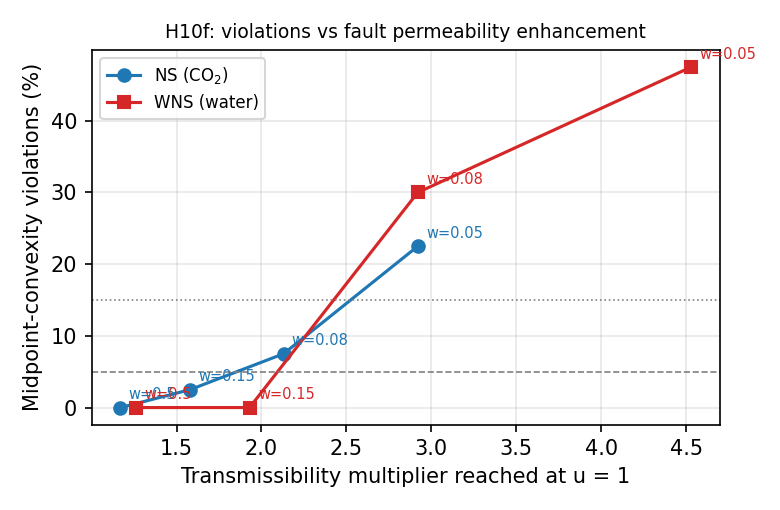

# Research Cycle 11 report (C49, 2026-11-03)

The plan and pre-registrations are in `CYCLE11_PLAN.md`, written before any run. Every run uses the ResSim C49 engine.
Scripts and logs are in `exp/`. New findings: F35 and F36 in `FINDINGS_LOG.md`.

| Test | Status | Result |
|---|---|---|
| H10f-a wider permeability ramp (2 × 40 pairs) | pre-registered | **SUPPORTED** 0/40 and 0/40, but **confounded** with amplitude |
| H10f-a dose-response, ramps 0.08 and 0.15 (4 × 40 pairs) | exploratory | violations only once the reached T multiplier exceeds ≈ 2 |
| H10f-b reactivation constraint (2 × 40 pairs) | pre-registered | **NON-DISCRIMINATING** (5 and 0 pairs with A and B feasible) |
| H11b GP-EI with 4 new training sets | pre-registered | **SUPPORTED** (1.060 / 1.011 / 1.005 / 1.000; median 1.008) |

## H10f-a: a wider permeability ramp (F35)

**Setup.** As H10e (NS: CO₂; WNS: water; sealing fault MULTFLT 0.02, permFactor 50, A1 pre-load 32 / 27 bar; pairs of seed 13).
Only FAULTMECH item 10 changed from 0.05 to 0.5. Pre-check: at u = 1, 10 (NS) and 8 (WNS) faces reach CFF > 0.

**Result.** 0/40 violations in both cases (median δ −0.109 / −0.124; max δ −5.3·10⁻³ / −4.0·10⁻³; ε 8.3·10⁻³ / 6.4·10⁻³).
Under the pre-registered criteria H10f-a is **SUPPORTED**. My stated expectation (still above 5 %) was wrong.

**Why this is not yet a repair.** The multiplier is permFactor^x with x = CFF / (w σ'n). Inside the ramp,
ln(multiplier) = ln(permFactor) · CFF / (w σ'n): a wider ramp is the *same exponential shape with a smaller slope*, not a
smoother switch. The `--fault-csv` column `mult` (new in C49) shows what happened at u = 1:

| Case | w = 0.05 (H10e) | 0.08 | 0.15 | 0.5 (H10f-a) |
|---|---|---|---|---|
| NS reached multiplier | 2.92 | 2.13 | 1.58 | 1.17 |
| NS violations / 40 | 9 | 3 | 1 | 0 |
| WNS reached multiplier | 4.53 | 2.92 | 1.93 | 1.26 |
| WNS violations / 40 | 19 | 12 | 0 | 0 |

The columns 0.08 and 0.15 are **exploratory** (run after the H10f-a result, same pairs and ε method). Verdicts under the
H10e criteria would be: NS 0.08 INCONCLUSIVE (8 %), WNS 0.08 REFUTED (30 %), both 0.15 SUPPORTED.

**Reading.** Violations appear once the transmissibility of the reactivated faces changes by more than about a factor of 2
within the design range. With a smaller enhancement the event count stays midpoint-convex, as in the no-switch controls of
Cycle 10. The variable that matters is the size of the hydraulic change, not how abruptly it is switched on. Both cases
agree on the threshold, although water reaches larger multipliers for the same ramp.

**Limits.** One 2-D section, one pre-load per case, four periods, an explicit one-report-step-lagged coupling, a one-way
Dieterich population, and the multiplier measured at u = 1 only (designs with higher late rates reach more). The threshold
"≈ 2" is an observation in this model, not a general constant.

## H10f-b: reactivation constraint

**Setup.** H10e switching (ramp 0.05), pre-load 3 bar below A1 (29 / 24 bar), so that u = 1 stays below failure (max CFF
−0.97 bar NS, −0.35 bar WNS). A design is feasible when no face reaches CFF ≥ 0.

**Result.** Only 5 (NS) and 0 (WNS) of 40 pairs have both designs feasible, below the pre-registered minimum of 10, so the
test is **non-discriminating**. For the record: the 5 NS midpoints were all feasible and none violated convexity.
**Design cost (descriptive):** 26/80 (NS) and 2/80 (WNS) random designs are feasible. Most schedules with the same total
injection push some face over failure even when the constant schedule does not. In this setting the constraint is therefore
very restrictive. As pre-registered, the pre-load was not re-tuned.

## H11b: GP-EI robustness to the training set (F36)

Four training seeds (101–104), 12 training + 12 EI evaluations each. Best moment 2.3488 / 2.2400 / 2.2261 / 2.2142·10¹⁵ N m.
Ratios to the H9b ES median best: 1.060 / 1.011 / 1.005 / 1.000; median 1.008, all ≤ 1.10 → **SUPPORTED**. Seed 101 is
only 0.4 % below the constant schedule (2.3578·10¹⁵): a training set that misses the low-moment region can leave 12 EI steps
short. A production workflow should use more evaluations or several training sets.

## Consequences

* **P1:** F31's statement "switching breaks convexity" is refined. Convexity survives modest permeability enhancement
  (≲ 2× over the design range) and fails above that. A sentence and the table above were added to the JGR draft discussion.
* **P2 (surrogate design):** F33 holds for 4/4 training sets at the 1.10 level. The weak seed argues for a larger budget.
* **Proposed Cycle 12:**
  * H10g: the threshold in terms of a dimensionless fault conductance contrast, tested on a second geometry.
  * H10f-b again, with a pre-load chosen so that ≥ 25 % of designs are feasible. This needs a new pre-registration.
  * H2f: gas fracturing with LEAKC on corner-point grids.
